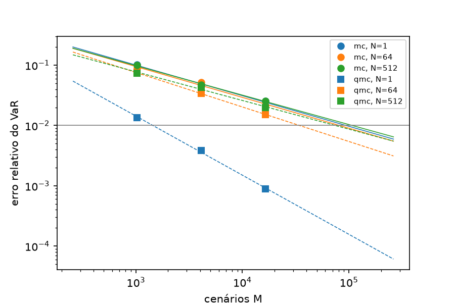
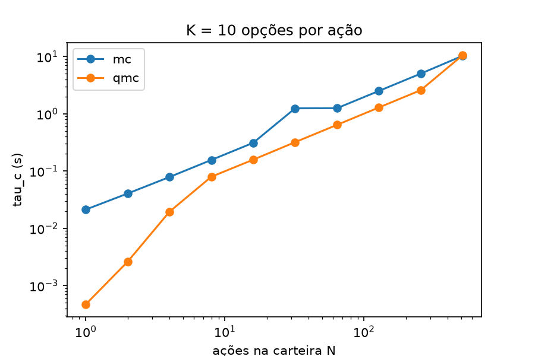
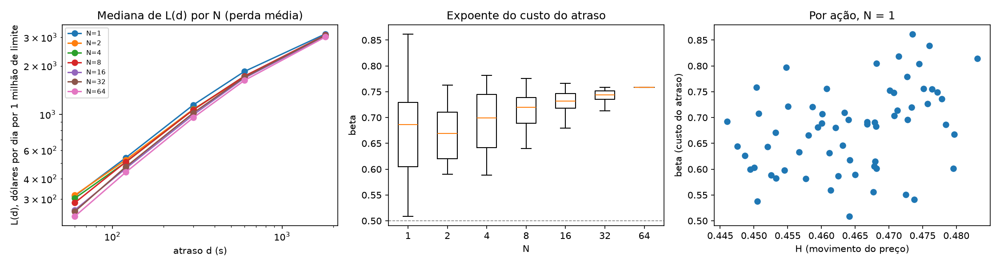
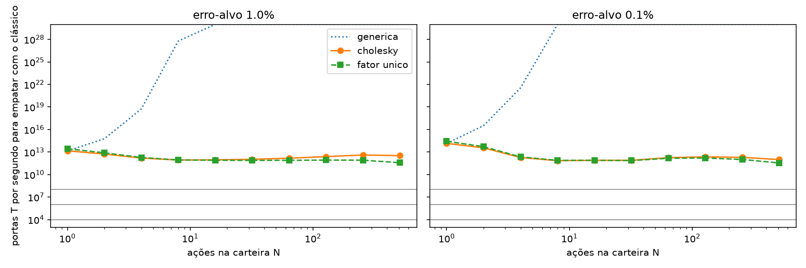
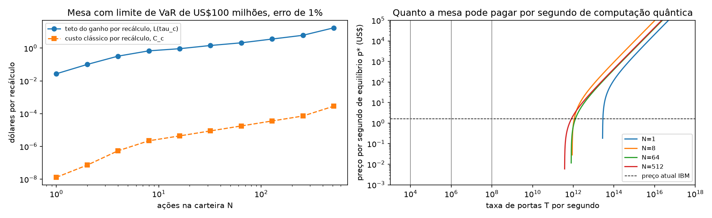

# Custo de equilíbrio da estimação quântica de amplitude frente ao Monte Carlo no recálculo intradiário do Value at Risk de carteiras de opções

Arthur Bretas, Lucas Magalhães, Henrique Botti

Inteli, Instituto de Tecnologia e Liderança

Orientadores: Erinaldo Fonseca e Bryan Ferreira

## Resumo

Bancos acompanham o Value at Risk (VaR) para controlar limites de risco, e em carteiras de opções ele costuma ser estimado por Monte Carlo. A estimação quântica de amplitude atinge o mesmo erro com quadraticamente menos amostras, e estudos anteriores estimaram os recursos quânticos necessários, mas nenhum converteu uma resposta mais rápida em valor financeiro. Este trabalho estima o custo de equilíbrio $X(N)$, o maior custo por execução quântica que ainda compensa recalcular o VaR 99% de 1 dia mais cedo, para carteiras de opções sobre $N$ ações. Um backtest sobre 2 anos de barras de 1 minuto de 64 ações americanas estima o custo do atraso como $L(d) = c\,d^{\beta}$, com $\beta$ entre 0,67 e 0,76, medido entre 1 e 30 minutos; o ganho por recálculo vem da extrapolação dessa lei para atrasos de milissegundos a segundos. Um modelo de portas T da estimação quântica, com a mesma carteira e o mesmo erro-alvo do Monte Carlo, mostra que, com carga por aritmética, a carga da distribuição consome de 90% a 99% das portas, e que o método quântico só entrega o VaR antes do clássico com $3{,}5 \times 10^{11}$ a $2{,}7 \times 10^{14}$ portas T por segundo, ao menos 3.500 vezes acima de $10^{8}$. Para uma mesa com US\$100 milhões de limite de VaR, a partir de 1,04 a 2,2 vezes essa taxa o preço atual de nuvem por segundo, se valesse para hardware tolerante a falhas, já cobriria a execução; o que limita a adoção é a velocidade do hardware. Para mesas de US\$1 milhão, o preço também passa a pesar. Os resultados dependem de constantes de ordem de grandeza no modelo quântico e de uma carteira sintética no cálculo do VaR.

**Palavras-chave:** computação quântica; estimação quântica de amplitude; Value at Risk; carteira de opções; custo de equilíbrio.

## Abstract

Quantum amplitude estimation requires quadratically fewer samples than Monte Carlo for the same error. Banks track Value at Risk (VaR) to control risk limits, and for option portfolios it is usually estimated by Monte Carlo. Previous studies estimated the quantum resources this would need, but none converted a faster answer into financial value. This study estimates the break-even cost $X(N)$, the largest cost per quantum execution that still pays for recalculating the 1-day 99% VaR earlier, for option portfolios on $N$ stocks. A backtest on 2 years of 1-minute bars for 64 US stocks estimates the cost of delay as $L(d) = c\,d^{\beta}$, with $\beta$ between 0.67 and 0.76, measured between 1 and 30 minutes; the gain per recalculation comes from extrapolating this law to delays of milliseconds to seconds. A T-gate model of quantum estimation, with the same portfolio and error target as Monte Carlo, shows that, with arithmetic loading, loading the distribution takes 90% to 99% of the gates, and that the quantum method only delivers the VaR before the classical one at $3.5 \times 10^{11}$ to $2.7 \times 10^{14}$ T gates per second, at least 3,500 times above $10^{8}$. For a desk with a US\$100 million VaR limit, from 1.04 to 2.2 times that rate the current cloud price per second, if it applied to fault-tolerant hardware, would already cover the execution, so hardware speed is what limits adoption. For US\$1 million desks, price also matters. The results depend on order-of-magnitude constants in the quantum model and on a synthetic portfolio in the VaR calculation.

**Keywords:** quantum computing; quantum amplitude estimation; Value at Risk; option portfolio; break-even cost.

## 1. Introdução

O Value at Risk (VaR) de nível 99% e horizonte de 1 dia é a perda que uma carteira só supera em 1% dos dias, e bancos o usam para fixar e acompanhar limites de risco [[1]](#referências). Em carteiras de opções, o valor das posições não é linear no preço das ações, e o VaR costuma ser estimado por Monte Carlo: sorteiam-se cenários de preço e reavalia-se a carteira em cada um [[2]](https://doi.org/10.1007/978-0-387-21617-1). Este trabalho considera uma mesa que recalcula o VaR ao longo do pregão: enquanto o cálculo roda, ela decide com a última estimativa disponível, e um limite estourado só é percebido, e protegido com hedge, depois do cálculo.

O tempo desse cálculo define a janela para qualquer ganho de velocidade. Neste trabalho, o VaR de uma carteira de 64 ações com 10 opções cada, com erro de 1%, levou 0,64 s num notebook, e o de 512 ações levou 10 s (seção 8.1). A janela é estreita, e por isso o valor de cada fração de segundo precisa ser medido. Carteiras com opções sem fórmula fechada exigem mais trabalho por cenário e levam mais tempo.

A estimação quântica de amplitude atinge o mesmo erro do Monte Carlo com quadraticamente menos amostras [[3]](https://doi.org/10.1090/conm/305/05215), [[4]](https://doi.org/10.1098/rspa.2015.0301), e foi proposta para precificar derivativos [[5]](https://doi.org/10.1103/PhysRevA.98.022321), [[6]](https://doi.org/10.22331/q-2020-07-06-291) e para calcular o VaR [[7]](https://doi.org/10.1038/s41534-019-0130-6). Na precificação de derivativos, a vantagem exigiria cerca de 8 mil qubits lógicos e profundidade T de 54 milhões, com o programa executado na ordem de um segundo [[8]](https://doi.org/10.22331/q-2021-06-01-463). Numa carteira de opções, cada ação é mais uma variável de risco que o circuito precisa carregar, e esse carregamento pode anular a vantagem [[9]](https://doi.org/10.1103/PhysRevE.103.063302).

Esses trabalhos estimam recursos e tempos, mas não convertem uma resposta mais rápida em valor financeiro, nem medem, no mesmo problema, como a carga da distribuição limita a vantagem quando a carteira cresce. Este trabalho investiga, assim, a seguinte pergunta: **para uma carteira de opções europeias sobre $N$ ações, sob quais cenários de hardware e de valor da informação o ganho de recalcular o VaR 99% de 1 dia por estimação quântica de amplitude cobre a diferença de custo em relação ao Monte Carlo e ao quasi-Monte Carlo, e qual é o maior custo por execução, $X(N)$, que mantém essa vantagem?**

Para isso, propõe-se estimar a curva de custo de equilíbrio $X(N)$ e a faixa de $N$ com vantagem de tempo, em relação ao Monte Carlo e ao quasi-Monte Carlo, sob diferentes cenários de hardware e de valor da informação. A comparação desconsidera fila e rede dos provedores de nuvem, como numa máquina dedicada, mas cobra cada execução pelo preço por segundo da nuvem. Há viabilidade técnica quando a estimação quântica entrega o VaR com o mesmo erro em menos tempo, e viabilidade econômica quando o ganho de recalcular mais cedo supera o custo adicional.

O efeito de $N$ pode ir nos dois sentidos. Choi, Moses e Thompson argumentam que a vantagem algorítmica do quântico só compensa a velocidade por operação do clássico em problemas maiores [[10]](https://doi.org/10.1109/JPROC.2025.3574102), o que favoreceria carteiras grandes; o quasi-Monte Carlo, que perde eficiência quando a dimensão cresce [[2]](https://doi.org/10.1007/978-0-387-21617-1), também piora o lado clássico com $N$. No sentido contrário, carregar $N$ variáveis com correlação genérica exige da ordem de $N^2$ multiplicações [[8]](https://doi.org/10.22331/q-2021-06-01-463), enquanto o Monte Carlo reavalia $N \times K$ opções por cenário, um custo linear em $N$. A primeira hipótese aposta no segundo efeito. **H1**: existe um $N^*$ acima do qual a carga da distribuição faz a estimação quântica levar tanto ou mais tempo que o melhor método clássico, para o mesmo erro; se ela já for mais lenta no menor $N$ testado, H1 vale de forma trivial, com $N^*$ igual ao menor $N$, e o resultado de interesse passa a ser a velocidade de hardware que a tornaria vantajosa. **H0**: a estimação quântica é mais rápida que o melhor método clássico em toda a faixa de $N$ testada. A segunda hipótese trata da parte econômica. **H2**: mesmo com hardware instantâneo, o preço por porta T de equilíbrio, $p_{T,\max}(N)$, fica ao menos uma ordem de grandeza abaixo do preço atual de execução quântica em nuvem convertido para portas T a $10^8$ portas T por segundo, para todo $N$ testado. Como a vantagem quântica está no número de amostras para um erro dado, as hipóteses são testadas com erro-alvo de 1% e de 0,1% do VaR.

As contribuições são:

1. um backtest sobre 2 anos de barras de 1 minuto de 64 ações americanas, que estima a lei do custo do atraso $L(d) = c\,d^{\beta}$;
2. um modelo de recursos da estimação quântica de amplitude para o VaR de $N$ ações, com a carga da distribuição separada do restante e o número de qubits por ação definido pelo erro-alvo;
3. a taxa de portas T e o preço por porta T que tornariam o método quântico vantajoso, em função de $N$ e do tamanho da mesa;
4. código e dados derivados em repositório público; as barras de mercado brutas são baixadas pelo próprio código, conforme os termos do provedor.

A seção 2 apresenta a fundamentação teórica e a seção 3 a revisão bibliográfica. A seção 4 formaliza o modelo de custo de equilíbrio, e as seções 5 a 7 descrevem a metodologia, os experimentos e as métricas. A seção 8 traz os resultados, a seção 9 as ameaças à validade e a seção 10 as conclusões. A seção 11 descreve o código e os dados.

## 2. Fundamentação teórica

### 2.1 VaR e expected shortfall

O VaR de nível $\alpha$ é o quantil $\alpha$ da perda da carteira no horizonte:

$$\mathrm{VaR}_{\alpha} = \min \{\, x : P(\text{perda} \le x) \ge \alpha \,\} \tag{1}$$

Este trabalho usa $\alpha = 99\%$ e horizonte de 1 dia útil. O expected shortfall (ES) de nível $\alpha$ é a perda média nos piores $1 - \alpha$ dos cenários; o regime de risco de mercado de Basileia (FRTB) adota o ES de 97,5% [[11]](https://www.bis.org/bcbs/publ/d457.htm). Em carteiras de opções, o VaR paramétrico, que supõe perda linear e normal, falha: numa carteira com delta zerado ele dá zero, embora a perda por gama seja positiva.

### 2.2 Monte Carlo e quasi-Monte Carlo

O Monte Carlo estima o VaR pelo quantil empírico de $M$ cenários. O erro padrão cai com $M^{-1/2}$, então um erro $\varepsilon$ exige $M$ da ordem de $\varepsilon^{-2}$ [[2]](https://doi.org/10.1007/978-0-387-21617-1). O quasi-Monte Carlo troca os sorteios por sequências de baixa discrepância, como a de Sobol, e pode chegar a erro da ordem de $M^{-1}$ em dimensão baixa; a vantagem diminui quando o número de variáveis de risco cresce [[2]](https://doi.org/10.1007/978-0-387-21617-1).

### 2.3 Estimação quântica de amplitude

Dado um operador $\mathcal{A}$ que prepara um estado em que a probabilidade de medir um qubit marcado é $a$, a estimação de amplitude estima $a$ com $M$ aplicações do operador de Grover construído a partir de $\mathcal{A}$, com erro de até $2\pi\sqrt{a(1-a)}/M + \pi^2/M^2$ com probabilidade de ao menos $8/\pi^2 \approx 81\%$ [[3]](https://doi.org/10.1090/conm/305/05215). Isso dá um ganho quadrático sobre o Monte Carlo na estimação de médias [[4]](https://doi.org/10.1098/rspa.2015.0301). Woerner e Egger aplicam o método ao risco: $\mathcal{A}$ carrega a distribuição dos fatores de risco, calcula a perda e marca os cenários com perda $\le x$; a estimação dá $P(\text{perda} \le x)$, e uma busca binária em $x$ encontra o VaR [[7]](https://doi.org/10.1038/s41534-019-0130-6). Para que o erro no VaR seja $\delta$, o erro na probabilidade precisa ser

$$\varepsilon_a = f(\mathrm{VaR})\,\delta \tag{2}$$

em que $f$ é a densidade da perda no VaR.

### 2.4 Carga da distribuição e aritmética quântica

Carregar a distribuição é preparar um estado cujas amplitudes ao quadrado são as probabilidades dos pontos da grade. O método genérico de Grover e Rudolph usa uma rotação por ponto [[12]](https://arxiv.org/abs/quant-ph/0208112): $2^{Nn}$ rotações para $N$ variáveis com $n$ qubits cada. Herbert mostra que esse custo elimina a vantagem quadrática [[9]](https://doi.org/10.1103/PhysRevE.103.063302). As alternativas carregam variáveis independentes e aplicam a correlação por aritmética, como na reparametrização usada por Chakrabarti et al. [[8]](https://doi.org/10.22331/q-2021-06-01-463), ou exploram funções que permitem preparação eficiente [[13]](https://doi.org/10.1103/PhysRevApplied.15.034027). A perda pode ser calculada por aproximação linear por partes [[7]](https://doi.org/10.1038/s41534-019-0130-6) ou por consulta a uma tabela (QROM), cujo custo cresce linearmente com o número de entradas [[14]](https://doi.org/10.1103/PhysRevX.8.041015). Somas e comparações usam somadores do tipo ripple-carry, com custo linear no número de bits [[15]](https://arxiv.org/abs/quant-ph/0410184).

### 2.5 Computação tolerante a falhas

Com correção de erros, como no código de superfície, as portas de Clifford são baratas, e a porta T exige estados mágicos produzidos em fábricas dedicadas [[16]](https://doi.org/10.1103/PRXQuantum.2.010103), [[17]](https://doi.org/10.48550/arXiv.2211.07629). Um Toffoli custa 7 portas T na decomposição usual [[18]](https://doi.org/10.1017/CBO9780511976667), e rotações arbitrárias são aproximadas por sequências de portas T com comprimento proporcional a $\log_2(1/\text{erro})$ [[19]](https://arxiv.org/abs/1403.2975). O tempo de execução fica limitado pela taxa de produção de portas T. Por isso a contagem de portas T é a unidade de custo deste trabalho, e a taxa de portas T por segundo é a variável de hardware.

### 2.6 Custo da latência

Se o preço segue um passeio aleatório, o movimento típico num intervalo $d$ cresce com $\sqrt{d}$. Moallemi e Saglam derivam o custo da latência na execução de ordens em função da volatilidade e do atraso [[20]](https://doi.org/10.1287/opre.2013.1165). Aqui o custo do atraso é estimado nos dados como $L(d) = c\,d^{\beta}$: $\beta = 0{,}5$ corresponde à escala do passeio aleatório, e $\beta = 1$ a um custo proporcional ao tempo.

## 3. Revisão bibliográfica

Herman et al. revisam aplicações da computação quântica em finanças, entre elas a análise de risco por simulação [[21]](https://doi.org/10.1038/s42254-023-00603-1). Rebentrost, Gupt e Bromley propõem o Monte Carlo quântico para precificar derivativos [[5]](https://doi.org/10.1103/PhysRevA.98.022321), e Stamatopoulos et al. implementam a precificação de opções europeias e de cesta em circuitos [[6]](https://doi.org/10.22331/q-2020-07-06-291). Woerner e Egger calculam VaR e CVaR por estimação de amplitude e simulam o circuito com poucos qubits [[7]](https://doi.org/10.1038/s41534-019-0130-6). Egger et al. estimam os recursos da análise de risco de crédito com $K$ ativos, com registradores que crescem com $K$ [[22]](https://doi.org/10.1109/TC.2020.3038063).

Chakrabarti et al. mostram, na precificação de derivativos, que a vantagem depende de qubits lógicos, profundidade T e relógio do hardware, e não só da complexidade assintótica [[8]](https://doi.org/10.22331/q-2021-06-01-463). Stamatopoulos et al. reduzem esses requisitos com gradientes quânticos [[23]](https://doi.org/10.22331/q-2022-07-20-770). Herbert mostra que a preparação de Grover-Rudolph elimina a vantagem [[9]](https://doi.org/10.1103/PhysRevE.103.063302), e Carrera Vazquez e Woerner propõem uma preparação que evita esse custo para uma classe de distribuições [[13]](https://doi.org/10.1103/PhysRevApplied.15.034027). Babbush et al. argumentam que ganhos quadráticos dificilmente superam o custo da correção de erros [[16]](https://doi.org/10.1103/PRXQuantum.2.010103). Choi, Moses e Thompson e Mejia et al. discutem quando a vantagem quântica aparece em tempo e em custo, sob premissas variáveis de hardware [[10]](https://doi.org/10.1109/JPROC.2025.3574102), [[24]](https://doi.org/10.48550/arXiv.2508.21031).

| Trabalho | Aplicação | O que estima | Limite para esta pergunta |
|---|---|---|---|
| Rebentrost et al. [[5]](https://doi.org/10.1103/PhysRevA.98.022321); Stamatopoulos et al. [[6]](https://doi.org/10.22331/q-2020-07-06-291) | precificação de derivativos | algoritmo e circuitos | sem tempo de hardware nem valor da resposta |
| Woerner e Egger [[7]](https://doi.org/10.1038/s41534-019-0130-6) | VaR e CVaR | algoritmo e simulação com poucos qubits | sem tempo de hardware nem carga para $N$ grande |
| Egger et al. [[22]](https://doi.org/10.1109/TC.2020.3038063) | risco de crédito com $K$ ativos | recursos em função de $K$ | sem valor monetário da resposta |
| Chakrabarti et al. [[8]](https://doi.org/10.22331/q-2021-06-01-463) | precificação de derivativos | qubits, profundidade T e relógio necessário | um derivativo, sem custo econômico |
| Stamatopoulos et al. [[23]](https://doi.org/10.22331/q-2022-07-20-770) | gregas e risco de mercado | redução de requisitos | sem custo econômico |
| Herbert [[9]](https://doi.org/10.1103/PhysRevE.103.063302); Carrera Vazquez e Woerner [[13]](https://doi.org/10.1103/PhysRevApplied.15.034027) | carga de distribuições | custo da preparação de estado | sem aplicação específica |
| Babbush et al. [[16]](https://doi.org/10.1103/PRXQuantum.2.010103) | ganhos quadráticos em geral | tempo de portas no código de superfície | sem aplicação financeira |
| Choi et al. [[10]](https://doi.org/10.1109/JPROC.2025.3574102); Mejia et al. [[24]](https://doi.org/10.48550/arXiv.2508.21031) | vantagem quântica em geral | quando o quântico supera o clássico | sem valor do tempo de resposta |
| Moallemi e Saglam [[20]](https://doi.org/10.1287/opre.2013.1165) | execução de ordens | custo da latência | sem relação com computação |

Nenhum desses trabalhos combina os recursos em função de $N$, incluindo a carga, com o valor monetário de receber a resposta mais cedo, e é essa combinação que este trabalho faz.

## 4. Modelo proposto

Decidir com uma estimativa de risco defasada custa mais quanto maior o atraso $\tau$, e a forma dessa relação é estimada nos dados. $L(\tau)$ é a perda média diária a mais quando o VaR chega com atraso $\tau$, em dólares por US\$1 milhão de limite de VaR. Para uma mesa com limite $V$ e um recálculo por minuto (390 por pregão), o ganho por recálculo de usar a resposta quântica é

$$L(\tau) = c\,\tau^{\beta} \tag{3}$$

$$\Delta R(N, K) = \frac{V}{10^6} \cdot \frac{L\big(\tau_c(N, K)\big) - L\big(\tau_q(N)\big)}{390} \tag{4}$$

A adoção é vantajosa quando o ganho supera a diferença de custo, e o custo de equilíbrio é o maior custo quântico que mantém essa condição:

$$\Delta R(N, K) > C_q(N) - C_c(N, K) \tag{5}$$

$$X(N, K) = C_c(N, K) + \Delta R(N, K) \tag{6}$$

Com uma taxa de $r$ portas T por segundo, o tempo quântico é $\tau_q(N) = T_q(N)/r$, e $X$ depende de $r$ por meio de $\tau_q$. Daí saem o preço por segundo e por porta T de equilíbrio e a taxa que empata os tempos:

$$p^*(N, K) = \frac{X(N, K)}{\tau_q(N)}, \qquad p_T^*(N, K) = \frac{X(N, K)}{T_q(N)} \tag{7}$$

$$r^*(N, K) = \frac{T_q(N)}{\tau_c(N, K)} \tag{8}$$

No limite de hardware instantâneo ($\tau_q \to 0$), o custo de equilíbrio atinge seu teto, $X_{\max} = C_c + \frac{V}{10^6} L(\tau_c)/390$, e o preço por porta T, o seu, $p_{T,\max} = X_{\max}/T_q$. A taxa $r_{IBM}$ é a menor $r$ em que $p^*$ alcança o preço por segundo cobrado hoje em nuvem.

- $c$ e $\beta$: escala e expoente do custo do atraso, estimados no backtest; o aumento do ES de 97,5% da perda diária, que mede risco de cauda, entra na análise de sensibilidade;
- $N$ e $K$: número de ações e de opções por ação; o método clássico reavalia $N \times K$ opções em cada cenário, enquanto no circuito a perda de cada ação vem de uma tabela de $2^n$ valores, que não depende de $K$;
- $\tau_c(N, K)$ e $\tau_q(N)$: tempo de cálculo até o VaR, com o mesmo erro, sem fila nem rede;
- $T_q(N)$: portas T de uma estimação quântica do VaR;
- $C_c(N, K)$ e $C_q(N)$: custo de uma execução em cada plataforma, o tempo de cálculo multiplicado pelo preço por segundo da nuvem. O ganho anual é $\Delta R \times 390 \times 252$.

O Monte Carlo divide os cenários entre processadores: com $P$ núcleos, $\tau_c$ cai para $\tau_c/P$ e $C_c$ não muda, porque o tempo total de processamento é o mesmo. A comparação com um computador clássico de custo equivalente, como em Mejia et al. [[24]](https://doi.org/10.48550/arXiv.2508.21031), multiplica $r^*$ por $P$. Os resultados usam uma única máquina, sem paralelização explícita, o caso mais favorável ao quântico.

Quando $\tau_q(N) \ge \tau_c(N, K)$, $\Delta R$ é nulo ou negativo, e o quântico só compensaria se custasse menos que o clássico. Para cada taxa de hardware, o menor $N$ em que isso acontece é o $N^*$ da hipótese H1. No restante do texto, $K = 10$, e $X(N)$ designa $X(N, 10)$ numa taxa $r$ dada.

## 5. Metodologia

Os objetivos específicos correspondem às etapas do estudo:

1. calcular o VaR por Monte Carlo, quasi-Monte Carlo e estimação quântica de amplitude com a mesma medida de erro (E1 e E3);
2. estimar, com um modelo analítico, as portas T e os qubits do circuito em função de $N$, separando a carga da distribuição (E3);
3. medir tempos clássicos e estimar tempos quânticos em função de $N$ (E1 e E3);
4. estimar a lei do custo do atraso com um backtest do recálculo do VaR e do hedge, com atrasos simulados (E2);
5. calcular $X(N)$, $p^*(N)$, $p_{T,\max}(N)$ e a taxa de empate $r^*(N)$, e analisar a sensibilidade à medida do custo do atraso, à carteira e ao tamanho da mesa (E4);
6. indicar, em cenários de hardware, a que velocidade e preço o método quântico passa a ser vantajoso (E4).

Os três métodos usam a mesma medida de erro: o desvio padrão da estimativa do VaR, com erro-alvo $\delta = \varepsilon \cdot \mathrm{VaR}$ e $\varepsilon$ de 1% ou 0,1%. No Monte Carlo e no quasi-Monte Carlo, o desvio é medido entre 50 sementes; no quasi-Monte Carlo, cada semente é um embaralhamento independente da sequência de Sobol. Na estimação quântica, $\delta$ vira um erro de probabilidade pela equação (2), e o modelo usa $\pi/\varepsilon_a$ chamadas de Grover por estimação. Três efeitos ficam fora dessa conta. A cota de Brassard et al. com $a \approx 0{,}99$ permite cerca de 5 vezes menos chamadas, o que favoreceria o quântico. Cada uma das 9 a 14 bisseções acerta com probabilidade de ao menos 81%, e garantir todas exige repetir cada estimação e tomar a mediana, o que multiplica as chamadas por uma ou duas dezenas. E os erros de discretização (até $\delta/2$), de estimação e de resolução da bisseção se somam, de modo que o erro quântico pode chegar a cerca de $2{,}5\delta$, o que também favorece o quântico. O saldo é de poucas vezes, muito menor que as distâncias encontradas.

O estudo tem quatro experimentos, cada um num notebook do repositório (seção 11).

1. E1, VaR clássico (`codigo/1_var_classico.ipynb`). As ações seguem movimento browniano geométrico correlacionado, com parâmetros sintéticos iguais para todas. Para cada ação, a carteira tem $K = 10$ opções europeias, em 5 straddles vendidos com strikes de 90% a 110% do preço atual e vencimento de 3 meses, e hedge de delta na própria ação (`codigo/carteira.py`). O VaR é calculado por Monte Carlo e quasi-Monte Carlo [[2]](https://doi.org/10.1007/978-0-387-21617-1), com reavaliação completa das opções por Black-Scholes. Para cada $N$ e método, o erro é medido em três valores de $M$ ($2^{10}$ a $2^{14}$), e a reta $\log(\text{erro}) \times \log(M)$ dá o $M$ necessário, arredondado para a potência de 2 acima, o que pode dobrar $\tau_c$. $\tau_c$ é a mediana de 3 execuções com esse $M$. Para o erro de 0,1%, $\tau_c$ é extrapolado pela mesma reta, até $M$ da ordem de $10^7$, e não medido.
2. E2, backtest do custo do atraso (`codigo/baixar_dados.py`, `codigo/2_backtest.ipynb`). Os preços das ações são barras de 1 minuto consolidadas de todas as bolsas dos EUA [[25]](https://docs.alpaca.markets/docs/about-market-data-api), das 64 ações com mais open interest em opções na data do download, de 1/11/2024 a 30/10/2026; as opções são sintéticas, reprecificadas por Black-Scholes com a volatilidade realizada. Cada dia é um episódio: a carteira é montada na abertura e encerrada no fechamento. A cada minuto, a mesa recebe o VaR calculado com os preços de $d$ minutos antes e, se ele passa do limite, reduz a carteira inteira pelo fator limite / VaR, recomprando parte dos straddles; o hedge de delta é refeito com a própria ação. O backtest mede, assim, a regra de decisão; o resultado de mercado das opções fica fora dele. O ajuste de $L(d) = c\,d^{\beta}$, com $d$ de 1 a 30 minutos, dá $c$ e $\beta$ por carteira, tanto para a perda média quanto para o ES. O mesmo notebook mede, por ação, o expoente $H$ do movimento de preço em $d$ minutos, para comparar com $\beta$.
3. E3, recursos quânticos (`codigo/3_var_quantico.ipynb`). Modelo analítico de portas T da estimação de amplitude para o VaR [[7]](https://doi.org/10.1038/s41534-019-0130-6), com a mesma carteira e a mesma medida de erro de E1. A carga é avaliada em três formas: genérica [[12]](https://arxiv.org/abs/quant-ph/0208112), com correlação por Cholesky e com fator único. A perda usa a opção mais barata entre aproximação linear por partes e tabela [[14]](https://doi.org/10.1103/PhysRevX.8.041015). O número de qubits por ação é o menor que mantém o erro de discretização, medido com $N = 1$, abaixo de metade do erro-alvo. O circuito não é simulado: com $N = 64$ ele tem mais de 1.250 qubits lógicos, e um simulador comporta 25 a 30.
4. E4, custo de equilíbrio (`codigo/4_equilibrio.ipynb`). Combina $\tau_c$ (E1), $c$ e $\beta$ (E2) e $T_q$ (E3) no modelo da seção 4, para cada $N$ e taxa de hardware, e faz a análise de sensibilidade.

As variáveis independentes são $N$, o método, o erro-alvo, a forma de carga, a taxa de portas T, a medida do custo do atraso e o limite da mesa. As dependentes são $\tau_c$, $H$, $c$, $\beta$, $T_q$, $r^*$, $\Delta R$, $X$, $p^*$ e $p_{T,\max}$. Ficam fixos o modelo de preços, a composição da carteira por ação, o nível de 99%, o horizonte de 1 dia, o período dos dados e as versões de software.

As referências clássicas são o Monte Carlo e o quasi-Monte Carlo, e $r^*$ é calculado contra o mais rápido dos dois em cada $N$ e também contra o Monte Carlo puro. O VaR paramétrico fica de fora porque supõe perda linear, o que a carteira com delta zerado viola por construção.

## 6. Descrição dos experimentos e parâmetros experimentais

| Experimento | Entrada | Saída |
|---|---|---|
| E1, VaR clássico | carteira sintética, $N$ de 1 a 512 | `dados/tau_c.csv`: $M$ necessário, inclinação do erro, $\tau_c$ |
| E2, backtest | barras de 1 minuto, $N$ de 1 a 64 | `dados/backtest_L.csv`, `dados/backtest_c_beta.csv`: $L(d)$, $c$, $\beta$ |
| E3, recursos quânticos | carteira sintética, $N$ de 1 a 512 | `dados/tau_q.csv`: qubits, $T_q$, $r^*$ |
| E4, equilíbrio | saídas de E1, E2 e E3 | `dados/equilibrio.csv`, `dados/sensibilidade.csv`: $X$, $p_{T,\max}$, $r_{IBM}$ |

| Parâmetro | Valor | Experimentos |
|---|---|---|
| Preço inicial, volatilidade e correlação sintéticos | 100; 25% ao ano; 0,3 | E1, E3 |
| Taxa livre de risco | 4% ao ano | todos |
| Opções por ação ($K$) | 10: 5 straddles vendidos, strikes de 90% a 110%, vencimento de 3 meses | todos |
| Nível e horizonte do VaR | 99%, 1 dia útil | todos |
| Erro-alvo $\varepsilon$ | 1% do VaR (e 0,1% em E3 e E4) | E1, E3, E4 |
| Sementes e valores de $M$ na lei do erro | 50; $2^{10}$, $2^{12}$ e $2^{14}$ | E1 |
| Hardware clássico | Apple arm64, macOS 27.2, numpy 2.5.4, uma máquina, sem paralelização explícita | E1 |
| Período e frequência dos dados | 1/11/2024 a 30/10/2026, barras de 1 minuto, pregão regular | E2 |
| Atrasos $d$ | 0, 1, 2, 5, 10 e 30 minutos | E2 |
| Limite de VaR | percentil 90 do VaR sem atraso | E2 |
| VaR no backtest | delta-gama com 1.000 cenários | E2 |
| Volatilidade e correlação | retornos diários de 20 e 60 dias; volatilidade intradiária por média exponencial com meia-vida de 30 minutos | E2 |
| Carteiras | 64 com $N = 1$; 20 sorteios para $N$ de 2 a 32; 1 com $N = 64$ | E2 |
| Qubits por ação $n$ | 8 ($\varepsilon$ = 1%) e 11 ($\varepsilon$ = 0,1%) | E3 |
| Custos aritméticos | somador de $b$ bits: $2b$ Toffolis; Toffoli: 7 portas T; rotação com erro $10^{-13}$: 130 portas T | E3 |
| Chamadas de Grover por estimação | $\pi/\varepsilon_a$ | E3 |
| Taxas de portas T | $10^4$, $10^6$ e $10^8$ por segundo | E3, E4 |
| Preço de nuvem quântica | US\$1,60 por segundo (IBM, pay-as-you-go) [[26]](https://www.ibm.com/quantum/pricing) | E4 |
| Preço de nuvem clássica | US\$0,10 por hora de vCPU, premissa de ordem de grandeza [[27]](https://aws.amazon.com/ec2/pricing/on-demand/) | E4 |
| Limite de VaR da mesa $V$ | US\$100 milhões; US\$1 milhão, US\$10 milhões e US\$1 bilhão na sensibilidade | E4 |

## 7. Métricas de avaliação

| Métrica | Definição | Unidade |
|---|---|---|
| $\tau_c(N)$ | tempo do melhor método clássico para o VaR com o erro-alvo | s |
| Inclinação do erro | $b$ em $\log(\text{erro}) = a + b \log M$; $-0{,}5$ no Monte Carlo puro | adimensional |
| $H$ | expoente de desvio(retorno em $d$ minutos) $\propto d^H$, por ação | adimensional |
| $L(d)$ | perda média diária com atraso $d$ menos a mesma sem atraso; na sensibilidade, o aumento do ES 97,5% | US\$ por dia, por US\$1 milhão de limite |
| $c$, $\beta$ | ajuste de $L(d) = c\,d^{\beta}$, com $d$ em segundos; mediana e quartis entre carteiras | $c$: US\$ por dia, por US\$1 milhão, por $\mathrm{s}^{\beta}$; $\beta$: adimensional |
| $T_q(N)$ | portas T de uma estimação do VaR | portas T |
| $r^*(N)$, $r_{IBM}(N)$ | taxa que empata os tempos; taxa em que $p^*$ alcança o preço da IBM | portas T por s |
| $\Delta R(N)$, $X(N)$, $X_{\max}(N)$ | ganho por recálculo; custo de equilíbrio por execução; seu teto com hardware instantâneo | US\$ por recálculo |
| $p^*(N)$ | preço por segundo de equilíbrio | US\$ por s |
| $p_{T,\max}(N)$ | preço por porta T de equilíbrio com hardware instantâneo | US\$ por porta T |

## 8. Resultados experimentais

### 8.1 VaR clássico (E1)

| $N$ | $M$ (MC) | $\tau_c$ MC (s) | $M$ (QMC) | $\tau_c$ QMC (s) | inclinação QMC |
|---|---|---|---|---|---|
| 1 | 131.072 | 0,021 | 2.048 | 0,0005 | $-0{,}98$ |
| 8 | 131.072 | 0,157 | 65.536 | 0,080 | $-0{,}49$ |
| 64 | 131.072 | 1,255 | 65.536 | 0,642 | $-0{,}57$ |
| 128 | 131.072 | 2,510 | 65.536 | 1,291 | $-0{,}57$ |
| 512 | 131.072 | 10,32 | 131.072 | 10,58 | $-0{,}48$ |

*Figura 1: erro relativo do VaR em função do número de cenários $M$, para $N$ = 1, 64 e 512.*

*Figura 2: tempo clássico $\tau_c$ para o erro-alvo de 1%, em função de $N$.*

A inclinação do erro do Monte Carlo ficou entre $-0{,}42$ e $-0{,}56$ em todos os $N$, perto do $-0{,}5$ teórico. O quasi-Monte Carlo erra como $M^{-1}$ com $N = 1$ (inclinação $-0{,}98$), cai para a taxa do Monte Carlo a partir de $N = 4$ e não tem vantagem com $N = 512$. Entre $N = 8$ e $N = 256$, o Monte Carlo leva cerca de 2 vezes o tempo do quasi-Monte Carlo (3,9 vezes em $N = 32$). $\tau_c$ cresce linearmente com $N$, cerca de 0,02 s por ação com o Monte Carlo, e chega a 10 s com $N = 512$. Em $N = 32$, o ajuste do Monte Carlo pediu o dobro de cenários dos vizinhos, uma oscilação do método de ajuste.

### 8.2 Custo do atraso (E2)

O expoente $H$ do movimento de preço ficou entre 0,446 e 0,483 nas 64 ações, com mediana de 0,465: perto do passeio aleatório (0,5) e quase igual entre as ações.

| $N$ | $L$(1 min) | $L$(5 min) | $L$(30 min) | $\beta$: mediana | $\beta$: quartis | $c$: mediana | $\beta$ do ES: mediana |
|---|---|---|---|---|---|---|---|
| 1 | 313 | 1.148 | 3.153 | 0,69 | 0,61 a 0,73 | 20,5 | 0,70 |
| 4 | 303 | 1.072 | 3.047 | 0,70 | 0,64 a 0,75 | 19,8 | 0,77 |
| 16 | 256 | 997 | 3.052 | 0,73 | 0,72 a 0,75 | 13,9 | 0,82 |
| 64 | 234 | 958 | 3.019 | 0,76 | - | 11,5 | 0,84 |

*$L$ é a perda média diária a mais, em US\$ por US\$1 milhão de limite; mediana entre as carteiras de cada $N$.*

*Figura 3: à esquerda, mediana de $L(d)$, pela perda média, por $N$; no centro, $\beta$ por $N$; à direita, $\beta$ contra $H$ por ação.*

$L$ cresce com o atraso em todas as 165 carteiras. A mediana de $\beta$ fica entre 0,67 e 0,76 conforme $N$ (0,51 a 0,86 entre as ações isoladas), entre a escala da raiz (0,5) e a linear (1), e não acompanha o $H$ de cada ação, o que indica que a forma do custo depende da regra de corte além do movimento do preço. Por US\$1 milhão de limite, $L$(1 min) cai 25% de $N = 1$ para $N = 64$: a diversificação reduz o valor de cada minuto de antecedência. Medido pelo ES de 97,5%, o custo do atraso é de 7 a 14 vezes maior, com $\beta$ entre 0,68 e 0,84, e a queda com $N$ chega a 61%.

### 8.3 Recursos quânticos (E3)

O erro de discretização do VaR, medido com $N = 1$, foi de $-14{,}8\%$, $-10{,}3\%$, $+1{,}48\%$, $-1{,}29\%$, $+0{,}135\%$, $+0{,}38\%$, $-0{,}19\%$, $+0{,}044\%$ e $+0{,}073\%$ com 4 a 12 qubits por ação. O erro não cai de forma monótona, porque o quantil discreto depende do alinhamento da grade; o modelo usa 8 qubits para o erro de 1% e 11 para 0,1%, os menores valores abaixo de metade do erro-alvo. A aproximação linear por partes precisou de 37 a 205 segmentos por ação, e a tabela foi mais barata em todos os casos. Cada estimação do VaR usa 9 a 10 bisseções, cada uma com cerca de 10 mil chamadas de Grover, perto de $10^5$ chamadas no total com erro de 1%.

| $N$ | qubits (Cholesky) | carga: Cholesky / fator único | $T_q$ Cholesky | $T_q$ fator único | $r^*$ Cholesky | $r^*$ fator único |
|---|---|---|---|---|---|---|
| 1 | 43 | 90% / 94% | $6{,}8 \times 10^{9}$ | $1{,}3 \times 10^{10}$ | $1{,}5 \times 10^{13}$ | $2{,}8 \times 10^{13}$ |
| 8 | 184 | 91% / 91% | $6{,}9 \times 10^{10}$ | $7{,}1 \times 10^{10}$ | $8{,}6 \times 10^{11}$ | $8{,}9 \times 10^{11}$ |
| 64 | 1.254 | 95% / 90% | $9{,}7 \times 10^{11}$ | $5{,}1 \times 10^{11}$ | $1{,}5 \times 10^{12}$ | $7{,}9 \times 10^{11}$ |
| 512 | 9.772 | 99% / 90% | $3{,}4 \times 10^{13}$ | $3{,}9 \times 10^{12}$ | $3{,}3 \times 10^{12}$ | $3{,}8 \times 10^{11}$ |

*Erro-alvo de 1%. Carga: parcela das portas T de cada operador de Grover gasta na carga da distribuição. $T_q$ em portas T por VaR; $r^*$ em portas T por segundo, contra o melhor método clássico.*

*Figura 4: taxa de portas T que empata o tempo quântico com o clássico, por forma de carga e erro-alvo. As linhas horizontais são os cenários de $10^4$, $10^6$ e $10^8$ portas T por segundo.*

Com carga por Cholesky ou por fator único (40 combinações de $N$, erro-alvo e carga), a carga da distribuição consome de 90% a 99% das portas T de cada operador de Grover, sobretudo pelas $2^n$ rotações de cada normal; o cálculo da perda por tabela e o comparador ficam com o restante. Em nenhuma combinação o quântico entrega o VaR antes do clássico nos três cenários de hardware. A taxa de empate fica entre $3{,}5 \times 10^{11}$ e $2{,}7 \times 10^{14}$ portas T por segundo, ao menos 3.500 vezes acima do cenário mais rápido. Com carga genérica, ela chega a $6 \times 10^{27}$ já em $N = 8$. Com Cholesky, a taxa de empate cai até $N = 8$ ($8{,}6 \times 10^{11}$), sobe até $4{,}1 \times 10^{12}$ em $N = 256$ e recua em $N = 512$, porque a carga cresce com $N^2$ e o clássico com $N$; o recuo final, como a queda de $r^*$ com fator único entre $N = 256$ e $N = 512$, vem de o quasi-Monte Carlo perder a vantagem, o que quadruplica $\tau_c$ quando $N$ dobra.

Contra o Monte Carlo puro, $r^*$ fica entre $2{,}0 \times 10^{11}$ e $3{,}3 \times 10^{12}$ com erro de 1%, e desce a $2{,}1 \times 10^{11}$ com erro de 0,1% (desconsiderando $N = 32$, cujo ajuste oscila; com ele, $8{,}5 \times 10^{10}$). Nesse caso, diminuir o erro-alvo favorece o quântico, como a teoria prevê, mas a taxa necessária continua ao menos 2.000 vezes acima de $10^8$. Contra o quasi-Monte Carlo, o erro de 0,1% muda pouco a taxa de empate: o clássico precisa de cerca de 10 a 100 vezes mais cenários, e o quântico de 10 vezes mais chamadas, cada uma cerca de 8 vezes mais cara (de 77 mil para 595 mil portas T por operador de Grover com $N = 1$), porque cada ação passa a ter 3 qubits a mais.

### 8.4 Custo de equilíbrio (E4)

Nos três cenários de hardware, $\Delta R$ é negativo em todo $N$, e portanto $X(N) < C_c$: a $10^8$ portas T por segundo, o quântico chega tão depois do clássico que o atraso custaria ao menos US\$96 por recálculo, e nenhum preço positivo torna a adoção vantajosa. A tabela mostra o teto $X_{\max}(N)$, que supõe hardware instantâneo.

| $N$ | $\tau_c$ (s) | $X_{\max}$ | ganho anual máximo | $C_c$ | $p_{T,\max}$ (US\$ por porta T) | $r^*$ (portas T/s) | $r_{IBM} / r^*$ |
|---|---|---|---|---|---|---|---|
| 1 | 0,0005 | 0,027 | 2,7 mil | $1{,}3 \times 10^{-8}$ | $2{,}1 \times 10^{-12}$ | $2{,}8 \times 10^{13}$ | 1,04 |
| 8 | 0,080 | 0,68 | 67 mil | $2{,}2 \times 10^{-6}$ | $9{,}7 \times 10^{-12}$ | $8{,}9 \times 10^{11}$ | 1,25 |
| 64 | 0,642 | 2,1 | 207 mil | $1{,}8 \times 10^{-5}$ | $4{,}2 \times 10^{-12}$ | $7{,}9 \times 10^{11}$ | 1,61 |
| 512 | 10,3 | 17,3 | 1,7 milhão | $2{,}9 \times 10^{-4}$ | $4{,}5 \times 10^{-12}$ | $3{,}8 \times 10^{11}$ | 2,16 |

*Carga com fator único, erro-alvo de 1%, perda média, mesa com limite de VaR de US\$100 milhões. $X_{\max}$ e $C_c$ em US\$ por recálculo; ganho anual em US\$, com 390 recálculos por dia e 252 pregões.*

*Figura 5: à esquerda, teto do ganho e custo clássico por recálculo em função de $N$; à direita, preço por segundo de equilíbrio $p^*$ em função da taxa de portas T, com o preço atual da IBM (tracejado) e os cenários de hardware (linhas verticais).*

O teto vai de US\$0,03 por recálculo com $N = 1$ a US\$17 com $N = 512$, ou de US\$2,7 mil a US\$1,7 milhão por ano, porque $\tau_c$ cresce com $N$. O custo clássico por recálculo é desprezível, no máximo US\$0,03. Em todas as 40 combinações, $p_{T,\max}$ fica entre $1{,}0 \times 10^{-13}$ e $1{,}0 \times 10^{-11}$ dólares. A IBM cobra hoje US\$1,60 por segundo [[26]](https://www.ibm.com/quantum/pricing); a $10^8$ portas T por segundo, isso equivaleria a $1{,}6 \times 10^{-8}$ dólares por porta, de 1.500 a 160.000 vezes acima.

Com erro de 1% e a mesa de US\$100 milhões, $r_{IBM}/r^*$ fica entre 1,04 e 2,2: pouco acima da taxa em que o quântico passa a ser mais rápido que o clássico, o preço atual por segundo já cobriria o custo, então o que limita a adoção é a velocidade do hardware.

| Caso ($N = 64$, erro de 1%, fator único) | $X_{\max}$ (US\$) | $r_{IBM} / r^*$ |
|---|---|---|
| perda média, mesa de US\$100 milhões (base) | 2,1 | 1,61 |
| ES de 97,5% no lugar da perda média | 10,1 | 1,12 |
| mesa de US\$1 bilhão | 21 | 1,07 |
| mesa de US\$10 milhões | 0,21 | 6,5 |
| mesa de US\$1 milhão | 0,021 | 51 |

*Com $N = 8$ e $N = 32$, as carteiras nos quartis de 25% e 75% do teto dão $r_{IBM}/r^*$ entre 1,18 e 1,50; as mesas de US\$1 milhão, de 21 a 38.*

A carteira escolhida e a medida do custo do atraso mudam $r_{IBM}/r^*$ pouco, entre 1,03 e 1,61. O tamanho da mesa muda muito: com US\$1 milhão de limite, o ganho por recálculo é 100 vezes menor, e o hardware precisaria ser de 21 a 51 vezes mais rápido que $r^*$ para o preço atual fechar a conta, de modo que, para mesas pequenas, preço e velocidade pesam juntos.

### 8.5 Hipóteses

**H0**, segundo a qual a estimação quântica seria mais rápida em toda a faixa de $N$, é rejeitada: com até $10^8$ portas T por segundo, ela não é mais rápida em nenhum $N$, erro-alvo ou forma de carga, nem contra o quasi-Monte Carlo nem contra o Monte Carlo puro.

**H1** vale na forma trivial prevista na seção 1: nas taxas consideradas não há vantagem nem com $N = 1$, então $N^*$ é o menor $N$ testado, contra as duas referências clássicas. O mecanismo da hipótese aparece na velocidade exigida. A carga é a parte dominante do custo, de 90% a 99% das portas T, e com correlação por Cholesky faz $r^*$ crescer de $8{,}6 \times 10^{11}$ em $N = 8$ para $4{,}1 \times 10^{12}$ portas T por segundo em $N = 256$. Com correlação de fator único, $r^*$ não cresce com $N$.

**H2** é confirmada: mesmo com hardware instantâneo, $p_{T,\max}$ fica entre $1{,}0 \times 10^{-13}$ e $1{,}0 \times 10^{-11}$ dólares por porta T, de 1.500 a 160.000 vezes abaixo do preço atual da IBM convertido a $10^8$ portas T por segundo, em todo $N$ testado. A hipótese mede preço a uma taxa fixa; quando a taxa cresce, o preço por porta T de um mesmo preço por segundo cai na mesma proporção, e por isso, acima de $r_{IBM}$, o preço atual por segundo já cobriria a execução para mesas grandes. No plano ($N$, erro-alvo), a região de vantagem não aparece em nenhum ponto testado; diminuir o erro-alvo a aproxima apenas quando a referência é o Monte Carlo puro.

## 9. Ameaças à validade

- Interna: as constantes do modelo quântico (somador de $2b$ Toffolis, 7 portas T por Toffoli, 130 portas T por rotação, $\pi/\varepsilon_a$ chamadas) são aproximações de ordem de grandeza, e a conta de chamadas deixa de fora a cota mais justa de Brassard et al., a repetição das bisseções e a soma dos erros (seção 5). A contagem de qubits omite o registrador de fase da estimação canônica e os qubits auxiliares da tabela e dos somadores. O tempo supõe portas T executadas uma a uma; com fábricas de estados mágicos em paralelo, como na profundidade T usada por Chakrabarti et al. [[8]](https://doi.org/10.22331/q-2021-06-01-463), a taxa efetiva é maior, e o cenário de $10^8$ portas T por segundo é uma escolha. Errar uma constante por 10 vezes move $r^*$ 10 vezes, mas não fecha uma distância de mais de 3.500 vezes. Desconsiderar fila e rede e usar uma única máquina clássica favorece o método quântico; a biblioteca de álgebra linear pode usar mais de um núcleo nas multiplicações de matriz, o que aproxima a referência clássica de $P > 1$. O preço por segundo usado é de hardware sem correção de erros, enquanto $T_q$ supõe hardware tolerante a falhas; por isso $p^*$ e $p_{T,\max}$ devem ser lidos como metas de preço.
- Externa: $c$ e $\beta$ valem para a regra de corte, o período e as ações testados, e não foram separados por regime de volatilidade. As ações foram escolhidas pelo open interest na data do download, o que introduz viés de sobrevivência e de olhar para o futuro. Só os preços das ações são reais: as opções do backtest são sintéticas, e E1 e E3 usam a carteira sintética, então o equilíbrio combina as duas fontes. Acima de $N = 64$, o equilíbrio usa $c$ e $\beta$ de $N = 64$; como $L$ cai com $N$, isso superestima o ganho e favorece o quântico. O ganho por recálculo vem da extrapolação de $L(d)$, medido entre 1 e 30 minutos, para atrasos de milissegundos a segundos, de 1 a 5 décadas abaixo dos dados; a extrapolação supõe o mesmo $\beta$ nas duas escalas, e a lei de potência não foi comparada com outras formas, como a exponencial ou o degrau.
- Construto: a estimação quântica não foi executada nem simulada; o número de chamadas vem da cota de Brassard et al. [[3]](https://doi.org/10.1090/conm/305/05215) e a estrutura do circuito de Woerner e Egger [[7]](https://doi.org/10.1038/s41534-019-0130-6). O VaR delta-gama do backtest supõe um choque de 1 dia sem reajuste do hedge, mas a carteira é reajustada a cada minuto e encerrada no fechamento; o ES de 97,5% realizado sem atraso fica em 7% a 9% do limite, e o limite funciona como um gatilho relativo (percentil 90), e não como uma medida de risco calibrada. A perda média mede o custo esperado do atraso; o ES mede o risco de cauda, e somá-lo como valor por dia superestimaria o ganho, por isso ele aparece só na sensibilidade. A referência clássica reavalia todas as opções em cada cenário; para opções europeias, uma tabela de reavaliação por ação deixaria $\tau_c$ quase independente de $K$ e menor, o que pioraria o quântico, então o resultado representa carteiras com opções sem fórmula fechada. O número de qubits por ação foi calibrado com $N = 1$, e o erro de discretização não cai de forma monótona com $n$.
- Conclusão: o ES de 97,5% de 439 dias se apoia em cerca de 11 dias por carteira; a perda média usa todos os dias. O ajuste do $M$ necessário oscila em alguns $N$ ($N = 32$ no Monte Carlo), o arredondamento para potência de 2 pode dobrar $\tau_c$, o $\tau_c$ com erro de 0,1% é extrapolado, e $\tau_c$ varia cerca de 4% entre execuções.

## 10. Conclusão

O trabalho mediu, no mesmo problema, o tempo do cálculo clássico do VaR, o valor de receber o VaR mais cedo e o custo quântico em portas T. O backtest mostrou que o atraso tem custo mensurável, com expoente $\beta$ entre 0,67 e 0,76 na perda média, e que a diversificação reduz esse custo por unidade de limite. O modelo de recursos mostrou que a carga da distribuição concentra de 90% a 99% do custo quântico. Com até $10^8$ portas T por segundo, a estimação quântica não chega antes do Monte Carlo em nenhum $N$; ela precisaria de $3{,}5 \times 10^{11}$ a $2{,}7 \times 10^{14}$ portas T por segundo. Para uma mesa de US\$100 milhões, a partir de 1,04 a 2,2 vezes essa taxa o preço atual de nuvem por segundo já cobriria a execução, se valesse para hardware tolerante a falhas; o que falta para a adoção é hardware com essa velocidade. Para mesas de US\$1 milhão, a taxa precisaria ser de 21 a 51 vezes maior que a de empate, e o preço também pesa.

Ficam como trabalhos futuros: validar o algoritmo em simulador para $N = 1$ com $n$ e precisão do acumulador reduzidos, para caber em cerca de 25 qubits; refazer a contagem de portas, com profundidade T e qubits auxiliares, num estimador de recursos tolerante a falhas [[17]](https://doi.org/10.48550/arXiv.2211.07629); avaliar métodos de carga eficientes [[13]](https://doi.org/10.1103/PhysRevApplied.15.034027), que atacam a maior parte do custo; estimar $c$ e $\beta$ por regime de volatilidade, com atrasos abaixo de 1 minuto, e comparar a lei de potência com outras formas; e incluir na referência clássica o paralelismo e a reavaliação por tabela.

## 11. Organização dos códigos e dados

Todo o código e os dados derivados estão no repositório. A ordem de execução está no `README.md`.

| Arquivo | Conteúdo | Experimento |
|---|---|---|
| `codigo/carteira.py` | carteira sintética e precificação; o bloco principal verifica que a perda é separável por ação | E1, E3 |
| `codigo/1_var_classico.ipynb` | VaR por Monte Carlo e quasi-Monte Carlo, lei do erro e $\tau_c$ | E1 |
| `codigo/baixar_dados.py` | download de contratos de opções e barras de 1 minuto da Alpaca; chaves em `.env`, fora do git | E2 |
| `codigo/2_backtest.ipynb` | $H$ por ação, backtest do corte com atraso, ajuste de $c$ e $\beta$ pela perda média e pelo ES | E2 |
| `codigo/3_var_quantico.ipynb` | modelo de portas T, qubits, parcela da carga e $r^*$ | E3 |
| `codigo/4_equilibrio.ipynb` | $X$, $X_{\max}$, $p_{T,\max}$, $r_{IBM}$ e a análise de sensibilidade | E4 |
| `figuras/` | figuras deste documento, gravadas pelos notebooks | todos |

| Dado | Origem | No repositório |
|---|---|---|
| `dados/opcoes_por_acao.csv` | contratos e open interest por ação (Alpaca) | sim |
| `dados/barras_1m.csv.gz` | 17,4 milhões de barras de 1 minuto (Alpaca, SIP), 212 MB | não; recriado por `codigo/baixar_dados.py` em cerca de 80 minutos, conforme os termos do provedor |
| `dados/tau_c.csv` | saída de E1 | sim |
| `dados/backtest_L.csv`, `dados/backtest_c_beta.csv` | saídas de E2 | sim |
| `dados/tau_q.csv` | saída de E3 | sim |
| `dados/equilibrio.csv`, `dados/sensibilidade.csv` | saídas de E4 | sim |

Os notebooks rodam com `uv run --with-requirements requirements.txt jupyter lab`. E1 leva cerca de 8 minutos, E2 cerca de 4, E3 e E4 menos de 1.

## Referências

[1] P. Jorion, *Value at Risk: The New Benchmark for Managing Financial Risk*, 3. ed. New York, NY, EUA: McGraw-Hill, 2007.

[2] P. Glasserman, *Monte Carlo Methods in Financial Engineering*. New York, NY, EUA: Springer, 2003, doi: [10.1007/978-0-387-21617-1](https://doi.org/10.1007/978-0-387-21617-1).

[3] G. Brassard, P. Hoyer, M. Mosca e A. Tapp, "Quantum amplitude amplification and estimation," em *Quantum Computation and Information*, ser. Contemporary Mathematics, vol. 305. Providence, RI, EUA: American Mathematical Society, 2002, pp. 53-74, doi: [10.1090/conm/305/05215](https://doi.org/10.1090/conm/305/05215).

[4] A. Montanaro, "Quantum speedup of Monte Carlo methods," *Proceedings of the Royal Society A*, vol. 471, no. 2181, art. 20150301, 2015, doi: [10.1098/rspa.2015.0301](https://doi.org/10.1098/rspa.2015.0301).

[5] P. Rebentrost, B. Gupt e T. R. Bromley, "Quantum computational finance: Monte Carlo pricing of financial derivatives," *Physical Review A*, vol. 98, art. 022321, 2018, doi: [10.1103/PhysRevA.98.022321](https://doi.org/10.1103/PhysRevA.98.022321).

[6] N. Stamatopoulos, D. J. Egger, Y. Sun, C. Zoufal, R. Iten, N. Shen e S. Woerner, "Option pricing using quantum computers," *Quantum*, vol. 4, art. 291, 2020, doi: [10.22331/q-2020-07-06-291](https://doi.org/10.22331/q-2020-07-06-291).

[7] S. Woerner e D. J. Egger, "Quantum risk analysis," *npj Quantum Information*, vol. 5, art. 15, 2019, doi: [10.1038/s41534-019-0130-6](https://doi.org/10.1038/s41534-019-0130-6).

[8] S. Chakrabarti, R. Krishnakumar, G. Mazzola, N. Stamatopoulos, S. Woerner e W. J. Zeng, "A threshold for quantum advantage in derivative pricing," *Quantum*, vol. 5, art. 463, 2021, doi: [10.22331/q-2021-06-01-463](https://doi.org/10.22331/q-2021-06-01-463).

[9] S. Herbert, "Problem with Grover-Rudolph state preparation for quantum Monte Carlo," *Physical Review E*, vol. 103, art. 063302, 2021, doi: [10.1103/PhysRevE.103.063302](https://doi.org/10.1103/PhysRevE.103.063302).

[10] S. Choi, W. S. Moses e N. Thompson, "The quantum tortoise and the classical hare: When will quantum computers outpace classical ones and when will they be left behind?," *Proceedings of the IEEE*, pp. 1-12, 2025, early access, doi: [10.1109/JPROC.2025.3574102](https://doi.org/10.1109/JPROC.2025.3574102).

[11] Basel Committee on Banking Supervision, "Minimum capital requirements for market risk," Bank for International Settlements, Basel, Suíça, 2019. [Online]. Disponível: [https://www.bis.org/bcbs/publ/d457.htm](https://www.bis.org/bcbs/publ/d457.htm).

[12] L. Grover e T. Rudolph, "Creating superpositions that correspond to efficiently integrable probability distributions," arXiv:quant-ph/0208112, 2002, preprint. [Online]. Disponível: [https://arxiv.org/abs/quant-ph/0208112](https://arxiv.org/abs/quant-ph/0208112).

[13] A. Carrera Vazquez e S. Woerner, "Efficient state preparation for quantum amplitude estimation," *Physical Review Applied*, vol. 15, art. 034027, 2021, doi: [10.1103/PhysRevApplied.15.034027](https://doi.org/10.1103/PhysRevApplied.15.034027).

[14] R. Babbush, C. Gidney, D. W. Berry, N. Wiebe, J. McClean, A. Paler, A. Fowler e H. Neven, "Encoding electronic spectra in quantum circuits with linear T complexity," *Physical Review X*, vol. 8, art. 041015, 2018, doi: [10.1103/PhysRevX.8.041015](https://doi.org/10.1103/PhysRevX.8.041015).

[15] S. A. Cuccaro, T. G. Draper, S. A. Kutin e D. P. Moulton, "A new quantum ripple-carry addition circuit," arXiv:quant-ph/0410184, 2004, preprint. [Online]. Disponível: [https://arxiv.org/abs/quant-ph/0410184](https://arxiv.org/abs/quant-ph/0410184).

[16] R. Babbush, J. R. McClean, M. Newman, C. Gidney, S. Boixo e H. Neven, "Focus beyond quadratic speedups for error-corrected quantum advantage," *PRX Quantum*, vol. 2, art. 010103, 2021, doi: [10.1103/PRXQuantum.2.010103](https://doi.org/10.1103/PRXQuantum.2.010103).

[17] M. E. Beverland, P. Murali, M. Troyer, K. M. Svore, T. Hoefler, V. Kliuchnikov, G. H. Low, M. Soeken, A. Sundaram e A. Vaschillo, "Assessing requirements to scale to practical quantum advantage," arXiv:2211.07629, 2022, preprint, doi: [10.48550/arXiv.2211.07629](https://doi.org/10.48550/arXiv.2211.07629).

[18] M. A. Nielsen e I. L. Chuang, *Quantum Computation and Quantum Information*, 10th anniversary ed. Cambridge, Reino Unido: Cambridge University Press, 2010, doi: [10.1017/CBO9780511976667](https://doi.org/10.1017/CBO9780511976667).

[19] N. J. Ross e P. Selinger, "Optimal ancilla-free Clifford+T approximation of z-rotations," *Quantum Information and Computation*, vol. 16, no. 11-12, pp. 901-953, 2016. [Online]. Disponível: [https://arxiv.org/abs/1403.2975](https://arxiv.org/abs/1403.2975).

[20] C. C. Moallemi e M. Saglam, "The cost of latency in high-frequency trading," *Operations Research*, vol. 61, no. 5, pp. 1070-1086, 2013, doi: [10.1287/opre.2013.1165](https://doi.org/10.1287/opre.2013.1165).

[21] D. Herman, C. Googin, X. Liu, Y. Sun, A. Galda, I. Safro, M. Pistoia e Y. Alexeev, "Quantum computing for finance," *Nature Reviews Physics*, vol. 5, pp. 450-465, 2023, doi: [10.1038/s42254-023-00603-1](https://doi.org/10.1038/s42254-023-00603-1).

[22] D. J. Egger, R. García Gutiérrez, J. C. Mestre e S. Woerner, "Credit risk analysis using quantum computers," *IEEE Transactions on Computers*, vol. 70, no. 12, pp. 2136-2145, 2021, doi: [10.1109/TC.2020.3038063](https://doi.org/10.1109/TC.2020.3038063).

[23] N. Stamatopoulos, G. Mazzola, S. Woerner e W. J. Zeng, "Towards quantum advantage in financial market risk using quantum gradient algorithms," *Quantum*, vol. 6, art. 770, 2022, doi: [10.22331/q-2022-07-20-770](https://doi.org/10.22331/q-2022-07-20-770).

[24] F. Mejia, H. Gundlach, J. Lynch, C. Dukatz, A. Lucas, E. Crane, P. Shukla e N. Thompson, "Introducing the quantum economic advantage online calculator," arXiv:2508.21031, 2025, preprint, doi: [10.48550/arXiv.2508.21031](https://doi.org/10.48550/arXiv.2508.21031).

[25] Alpaca, "About Market Data API." [Online]. Disponível: [https://docs.alpaca.markets/docs/about-market-data-api](https://docs.alpaca.markets/docs/about-market-data-api). Acesso em: 6 nov. 2026.

[26] IBM, "IBM Quantum pricing plans." [Online]. Disponível: [https://www.ibm.com/quantum/pricing](https://www.ibm.com/quantum/pricing). Acesso em: 4 nov. 2026.

[27] Amazon Web Services, "Amazon EC2 On-Demand Pricing." [Online]. Disponível: [https://aws.amazon.com/ec2/pricing/on-demand/](https://aws.amazon.com/ec2/pricing/on-demand/). Acesso em: 5 nov. 2026.
