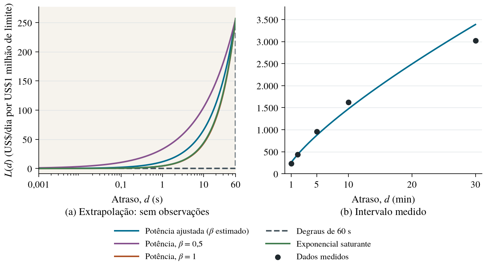
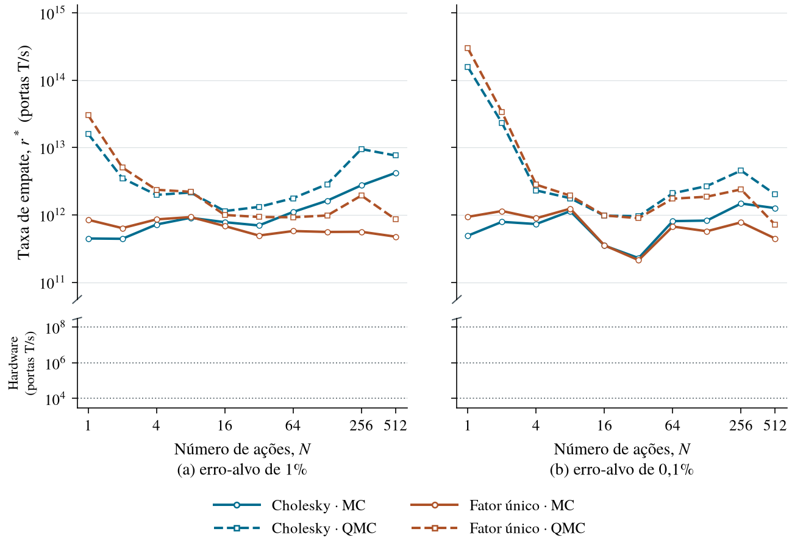

# Custo de equilíbrio da estimação quântica de amplitude frente ao Monte Carlo no recálculo intradiário do Value at Risk de carteiras de opções

Arthur Bretas, Lucas Magalhães, Henrique Botti

Inteli, Instituto de Tecnologia e Liderança

Orientadores: Erinaldo Fonseca e Bryan Ferreira

## Resumo

Este trabalho estima a taxa de empate e o teto econômico da estimação quântica de amplitude no VaR intradiário de carteiras de opções. Comparam-se Monte Carlo e quasi-Monte Carlo com um modelo lógico e um estimador tolerante a falhas que inclui profundidade e fábricas paralelas. O erro clássico de 1% é verificado entre 50 sementes; o tempo de 0,1% é extrapolado. Considerando ambos os alvos, o requisito agregado varia de $7{,}1\times10^{11}$ a $3\times10^{14}$ portas T/s. Um backtest mede o custo de uma regra de corte com atrasos entre 1 e 30 minutos. Abaixo dessa escala, cinco formas funcionais produzem tetos econômicos distintos. Esses valores são cenários condicionais à forma assumida e à transferência do indicador aproximado de VaR para a reavaliação completa. As metas de preço não são cotações de hardware tolerante a falhas.

**Palavras-chave:** estimação quântica de amplitude; Value at Risk; recursos tolerantes a falhas; custo do atraso; cenários econômicos.

## Abstract

This study estimates the break-even throughput and economic ceiling of quantum amplitude estimation for intraday VaR of option portfolios. Monte Carlo and quasi-Monte Carlo are compared with a logical model and a fault-tolerant estimator accounting for depth and parallel magic-state factories. The classical 1% error target is checked across 50 seeds; runtime for 0.1% is extrapolated. Across both targets, the aggregate requirement ranges from $7.1\times10^{11}$ to $3\times10^{14}$ T gates/s. A backtest measures a risk-limit rule's cost for delays of 1 to 30 minutes. Below that interval, five functional forms produce different economic ceilings. These are scenarios conditional on the assumed functional form and on transferring the approximate VaR indicator to full revaluation. Price targets are not quotations for fault-tolerant hardware.

**Keywords:** quantum amplitude estimation; Value at Risk; fault-tolerant resources; latency cost; economic scenarios.

## 1. Introdução

O Value at Risk (VaR) de nível 99% e horizonte de 1 dia é a perda que uma carteira só supera em 1% dos dias, e bancos o usam para acompanhar limites de risco [[1]](#referências). Em carteiras de opções, o valor das posições não é linear no preço das ações, e o VaR pode ser estimado por Monte Carlo: sorteiam-se cenários e reavalia-se a carteira em cada um [[2]](https://doi.org/10.1007/978-0-387-21617-1). Considera-se uma mesa que recebe estimativas ao longo do pregão e reduz suas posições quando o VaR informado supera um limite.

A estimação quântica de amplitude reduz quadraticamente o número de consultas necessário para estimar uma probabilidade com erro dado [[3]](https://doi.org/10.1090/conm/305/05215), [[4]](https://doi.org/10.1098/rspa.2015.0301). Essa propriedade motivou aplicações em derivativos [[5]](https://doi.org/10.1103/PhysRevA.98.022321), [[6]](https://doi.org/10.22331/q-2020-07-06-291) e risco [[7]](https://doi.org/10.1038/s41534-019-0130-6). A vantagem em consultas, porém, depende do custo da preparação da distribuição, da aritmética e da correção de erros [[8]](https://doi.org/10.22331/q-2021-06-01-463), [[9]](https://doi.org/10.1103/PhysRevE.103.063302).

A pergunta deste estudo é: **que taxa agregada de portas T é necessária para empatar com o Monte Carlo e o quasi-Monte Carlo no VaR de carteiras de opções sobre $N$ ações, e qual é o teto de custo por execução que poderia ser justificado pelo recebimento antecipado dessa informação, sob cenários explícitos de custo do atraso?**

São separados dois resultados. O requisito técnico $r^*(N)$ relaciona o trabalho lógico quântico ao tempo clássico medido; uma estimativa tolerante a falhas examina também a profundidade e a produção paralela de estados mágicos. O teto econômico $X_{\max}(N)$ é condicional a uma regra de decisão e à forma de $L(d)$ fora da escala observada. Ele não é uma estimativa de lucro realizável com hardware disponível.

As hipóteses são verificadas nas combinações explicitamente testadas:

- **H1:** para erro-alvo de 1% e $8 \leq N \leq 512$, a inclinação do ajuste de $\log r^*$ contra $\log N$ é maior com Cholesky do que com fator único, tanto contra Monte Carlo quanto contra quasi-Monte Carlo. A hipótese é refutada se a desigualdade falhar em qualquer uma das duas referências. **H0:** em pelo menos uma das referências, a inclinação de Cholesky é menor ou igual à de fator único.
- **H2:** nas duas formas de carga por aritmética e nos erros-alvo de 1% e 0,1%, $r^*(N)$ supera $10^8$ portas T/s em todos os $N$ testados, contra ambas as referências clássicas. Um único caso com $r^* \leq 10^8$ refuta a hipótese. O resultado de 0,1% usa o tempo clássico extrapolado e é apresentado separadamente.

As contribuições são a medição do tempo clássico com validação do erro-alvo, a decomposição dos recursos quânticos por forma de carga, a estimativa física condicional ao escalonamento lógico e a comparação de cenários econômicos de latência. O backtest usa 2 anos de barras de 1 minuto de 64 ações americanas; a carteira de opções é sintética. O código e os dados derivados estão disponíveis em [github.com/LucasMaga00/quant-search](https://github.com/LucasMaga00/quant-search).

## 2. Fundamentação teórica

### 2.1 VaR e expected shortfall

O VaR de nível $\alpha$ é o quantil $\alpha$ da perda da carteira no horizonte:

$$\mathrm{VaR}_{\alpha} = \min \{\, x : P(\text{perda} \le x) \ge \alpha \,\} \tag{1}$$

Este trabalho usa $\alpha = 99\%$ e horizonte de 1 dia útil. O expected shortfall (ES) de nível $\alpha$ é a perda média nos piores $1 - \alpha$ dos cenários; o regime de risco de mercado de Basileia (FRTB) adota o ES de 97,5% [[11]](https://www.bis.org/bcbs/publ/d457.htm). Em carteiras de opções, o VaR paramétrico, que supõe perda linear e normal, falha: numa carteira com delta zerado ele dá zero, embora a perda por gama seja positiva.

### 2.2 Monte Carlo e quasi-Monte Carlo

O Monte Carlo estima o VaR pelo quantil empírico de $M$ cenários. O erro padrão cai com $M^{-1/2}$, então um erro $\varepsilon$ exige $M$ da ordem de $\varepsilon^{-2}$ [[2]](https://doi.org/10.1007/978-0-387-21617-1). O quasi-Monte Carlo troca os sorteios por sequências de baixa discrepância, como a de Sobol, e pode chegar a erro da ordem de $M^{-1}$ em dimensão baixa; a vantagem diminui quando o número de variáveis de risco cresce [[2]](https://doi.org/10.1007/978-0-387-21617-1).

### 2.3 Estimação quântica de amplitude

Dado um operador $\mathcal{A}$ que prepara um estado em que a probabilidade de medir um qubit marcado é $a$, a estimação de amplitude estima $a$ com $M$ aplicações do operador de Grover construído a partir de $\mathcal{A}$, com erro de até $2\pi\sqrt{a(1-a)}/M + \pi^2/M^2$ com probabilidade de ao menos $8/\pi^2 \approx 81\%$ [[3]](https://doi.org/10.1090/conm/305/05215). Isso dá um ganho quadrático sobre o Monte Carlo na estimação de médias [[4]](https://doi.org/10.1098/rspa.2015.0301). Woerner e Egger aplicam o método ao risco: $\mathcal{A}$ carrega a distribuição dos fatores de risco, calcula a perda e marca os cenários com perda $\le x$; a estimação dá $P(\text{perda} \le x)$, e uma busca binária em $x$ encontra o VaR [[7]](https://doi.org/10.1038/s41534-019-0130-6). Para que o erro no VaR seja $\delta$, o erro na probabilidade precisa ser

$$\varepsilon_a = f(\mathrm{VaR})\,\delta \tag{2}$$

em que $f$ é a densidade da perda no VaR.

### 2.4 Carga da distribuição e aritmética quântica

Carregar a distribuição é preparar um estado cujas amplitudes ao quadrado são as probabilidades dos pontos da grade. O método genérico de Grover e Rudolph usa uma rotação por ponto [[12]](https://arxiv.org/abs/quant-ph/0208112): $2^{Nn}$ rotações para $N$ variáveis com $n$ qubits cada. Herbert mostra que esse custo elimina a vantagem quadrática [[9]](https://doi.org/10.1103/PhysRevE.103.063302). As alternativas carregam variáveis independentes e aplicam a correlação por aritmética, como na reparametrização usada por Chakrabarti et al. [[8]](https://doi.org/10.22331/q-2021-06-01-463), ou exploram funções que permitem preparação eficiente [[13]](https://doi.org/10.1103/PhysRevApplied.15.034027). A perda pode ser calculada por aproximação linear por partes [[7]](https://doi.org/10.1038/s41534-019-0130-6) ou por consulta a uma tabela (QROM), cujo custo cresce linearmente com o número de entradas [[14]](https://doi.org/10.1103/PhysRevX.8.041015). Somas e comparações usam somadores do tipo ripple-carry, com custo linear no número de bits [[15]](https://arxiv.org/abs/quant-ph/0410184).

### 2.5 Computação tolerante a falhas

Com correção de erros, a execução de portas T requer estados mágicos produzidos por fábricas de destilação [[16]](https://doi.org/10.1103/PRXQuantum.2.010103). A **contagem T** mede o trabalho total, enquanto a **profundidade T** mede as camadas dependentes que não podem ser executadas simultaneamente. Fábricas paralelas podem aumentar a oferta de estados, mas não removem as dependências do algoritmo. Uma taxa agregada de portas, isoladamente, não determina o tempo físico.

Beverland et al. relacionam recursos lógicos a arquiteturas físicas, correção de erros e destilação [[17]](https://doi.org/10.48550/arXiv.2211.07629). Este trabalho executa o estimador local do QDK para modelos de blocos com escalonamento explícito [[31]](https://learn.microsoft.com/en-us/azure/quantum/quickstart-microsoft-resources-estimator). A decomposição de referência usa 7 portas T por Toffoli [[18]](https://doi.org/10.1017/CBO9780511976667) e 130 portas T por rotação com erro de síntese $10^{-13}$, aproximação compatível com crescimento logarítmico do custo de síntese [[19]](https://arxiv.org/abs/1403.2975). O estimador converte esse modelo em recursos físicos; não constitui síntese independente do oráculo completo.

### 2.6 Custo da latência

O movimento típico de um passeio aleatório cresce com $\sqrt d$, mas essa propriedade dos preços não determina o custo de uma regra de negociação. Moallemi e Saglam relacionam latência, volatilidade e execução de ordens [[20]](https://doi.org/10.1287/opre.2013.1165). Aqui, a intervenção só ocorre quando o VaR informado ultrapassa um gatilho; a posição reduzida e o hedge afetam os resultados dos minutos seguintes. O custo depende, portanto, da frequência de cruzamento do limite, da intensidade dos cortes e da trajetória posterior.

A forma $L(d)=cd^\beta$ é uma parametrização empírica dessa regra entre 1 e 30 minutos, e não uma consequência teórica do expoente $H$ dos retornos. Os dados não identificam sua continuação abaixo de 1 minuto. Nessa escala, são comparadas hipóteses de potência, degrau e exponencial; os valores monetários obtidos são cenários condicionais a essas formas.

## 3. Revisão bibliográfica

Herman et al. revisam aplicações da computação quântica em finanças, entre elas a análise de risco por simulação [[21]](https://doi.org/10.1038/s42254-023-00603-1). Rebentrost, Gupt e Bromley propõem o Monte Carlo quântico para precificar derivativos [[5]](https://doi.org/10.1103/PhysRevA.98.022321), e Stamatopoulos et al. implementam a precificação de opções europeias e de cesta em circuitos [[6]](https://doi.org/10.22331/q-2020-07-06-291). Woerner e Egger calculam VaR e CVaR por estimação de amplitude e simulam o circuito com poucos qubits [[7]](https://doi.org/10.1038/s41534-019-0130-6). Egger et al. estimam os recursos da análise de risco de crédito com $K$ ativos, com registradores que crescem com $K$ [[22]](https://doi.org/10.1109/TC.2020.3038063).

Chakrabarti et al. mostram, na precificação de derivativos, que a vantagem depende de qubits lógicos, profundidade T e relógio do hardware, e não só da complexidade assintótica [[8]](https://doi.org/10.22331/q-2021-06-01-463). Stamatopoulos et al. reduzem esses requisitos com gradientes quânticos [[23]](https://doi.org/10.22331/q-2022-07-20-770). Herbert mostra que a preparação de Grover-Rudolph elimina a vantagem [[9]](https://doi.org/10.1103/PhysRevE.103.063302), e Carrera Vazquez e Woerner propõem uma preparação que evita esse custo para uma classe de distribuições [[13]](https://doi.org/10.1103/PhysRevApplied.15.034027). Babbush et al. argumentam que ganhos quadráticos dificilmente superam o custo da correção de erros [[16]](https://doi.org/10.1103/PRXQuantum.2.010103). Choi, Moses e Thompson e Mejia et al. discutem quando a vantagem quântica aparece em tempo e em custo, sob premissas variáveis de hardware [[10]](https://doi.org/10.1109/JPROC.2025.3574102), [[24]](https://doi.org/10.48550/arXiv.2508.21031).

| Trabalho | Aplicação | O que estima | Limite para esta pergunta |
|---|---|---|---|
| Rebentrost et al. [[5]](https://doi.org/10.1103/PhysRevA.98.022321); Stamatopoulos et al. [[6]](https://doi.org/10.22331/q-2020-07-06-291) | precificação de derivativos | algoritmo e circuitos | sem tempo de hardware nem valor da resposta |
| Woerner e Egger [[7]](https://doi.org/10.1038/s41534-019-0130-6) | VaR e CVaR | algoritmo e simulação com poucos qubits | sem tempo de hardware nem carga para $N$ grande |
| Egger et al. [[22]](https://doi.org/10.1109/TC.2020.3038063) | risco de crédito | recursos em função de $K$ | sem valor monetário da resposta |
| Chakrabarti et al. [[8]](https://doi.org/10.22331/q-2021-06-01-463) | precificação de derivativos | qubits, profundidade T e relógio necessário | um derivativo, sem custo econômico |
| Stamatopoulos et al. [[23]](https://doi.org/10.22331/q-2022-07-20-770) | gregas e risco de mercado | redução de requisitos | sem custo econômico |
| Herbert [[9]](https://doi.org/10.1103/PhysRevE.103.063302); Carrera Vazquez e Woerner [[13]](https://doi.org/10.1103/PhysRevApplied.15.034027) | carga de distribuições | custo da preparação de estado | sem aplicação específica |
| Babbush et al. [[16]](https://doi.org/10.1103/PRXQuantum.2.010103) | ganhos quadráticos em geral | tempo de portas no código de superfície | sem aplicação financeira |
| Choi et al. [[10]](https://doi.org/10.1109/JPROC.2025.3574102); Mejia et al. [[24]](https://doi.org/10.48550/arXiv.2508.21031) | vantagem quântica em geral | quando o quântico supera o clássico | sem valor do tempo de resposta |
| Moallemi e Saglam [[20]](https://doi.org/10.1287/opre.2013.1165) | execução de ordens | custo da latência | sem relação com computação |
| Stamatopoulos et al. [[28]](https://arxiv.org/abs/2404.10088); Beverland et al. [[17]](https://doi.org/10.48550/arXiv.2211.07629) | VaR de derivativos; estimação física | recursos, relógio lógico e custo de correção de erros | sem calibração da regra intradiária de corte |
| Iaconis et al. [[29]](https://doi.org/10.1038/s41534-024-00805-0); Xie e Ben-Ami [[30]](https://arxiv.org/abs/2507.20317) | carga de gaussianas | circuitos estruturados e precisão | exigem novo orçamento de erros para esta carteira |

Stamatopoulos et al. analisam VaR e CVaR de derivativos com estimação de amplitude e processamento quântico de sinais, incluindo requisitos de recursos e de relógio lógico [[28]](https://arxiv.org/abs/2404.10088). Esse trabalho aproxima a revisão da aplicação estudada, mas não calibra o valor monetário de uma regra intradiária de corte. Beverland et al. [[17]](https://doi.org/10.48550/arXiv.2211.07629) fornecem a ligação entre recursos lógicos e físicos usada na implementação do estimador local [[31]](https://learn.microsoft.com/en-us/azure/quantum/quickstart-microsoft-resources-estimator).

Na preparação de estado, Iaconis, Johri e Zhu usam estados de produto de matrizes para aproximar distribuições normais, analisando fontes de erro e profundidade [[29]](https://doi.org/10.1038/s41534-024-00805-0). Xie e Ben-Ami combinam rotações e transformada quântica de Fourier para aproximar gaussianas [[30]](https://arxiv.org/abs/2507.20317). São alternativas relevantes porque a carga domina o modelo aqui adotado; suas contagens não são intercambiáveis sem recalibrar a precisão. Elas integram a revisão, mas não são implementadas neste estudo.

A lacuna examinada é a combinação, no mesmo cenário de carteira, de trabalho lógico dependente de $N$, tempo clássico e teto monetário condicional a uma regra de decisão. A comparação econômica é uma análise de cenários, não uma demonstração de vantagem disponível.

## 4. Modelo proposto

### 4.1 Requisito técnico

Se $T_q(N)$ é o trabalho total em portas T de um VaR e $\tau_c(N,K)$ é o tempo clássico com o mesmo erro-alvo, a taxa agregada necessária para empatar os tempos é

$$r^*(N,K)=\frac{T_q(N)}{\tau_c(N,K)}. \tag{3}$$

No modelo de vazão, $\tau_q=T_q/r$. Essa relação é um cenário de taxa efetiva entregue ao programa, sem fila nem rede. Com execução paralela, a condição $r>r^*$ é necessária, mas não suficiente: a profundidade e os ciclos de correção de erros também limitam o tempo. E3 apresenta a estimativa física desses limites em separado.

### 4.2 Cenários econômicos

$L(d)$ é o aumento da perda média diária provocado pelo atraso $d$, em dólares por US\$1 milhão de limite de VaR. Para limite da mesa $V$ e frequência desejada $F=390$ recálculos por dia,

$$\Delta R(N,K)=\frac{V}{10^6}\frac{L(\tau_c(N,K))-L(\tau_q(N))}{F}, \tag{4}$$

$$X(N,K)=C_c(N,K)+\Delta R(N,K). \tag{5}$$

Uma execução com custo $C_q<X$ é economicamente favorável dentro do cenário assumido. Os custos são por execução; $C_c$ usa a premissa de US\$0,10 por hora de vCPU [[27]](https://aws.amazon.com/ec2/pricing/on-demand/). Com hardware instantâneo, o teto é

$$X_{\max}(N,K)=C_c(N,K)+\frac{V}{10^6}\frac{L(\tau_c(N,K))}{F}. \tag{6}$$

$$p^*(N,K)=\frac{X(N,K)}{\tau_q(N)},\qquad p_{T,\max}(N,K)=\frac{X_{\max}(N,K)}{T_q(N)}. \tag{7}$$

$p^*$ e $p_{T,\max}$ são metas de preço condicionais. O valor de US\$1,60/s documentado na versão anterior para a nuvem IBM [[26]](https://www.ibm.com/quantum/pricing) é mantido apenas como referência hipotética $p_{\rm ref}$. Não é uma cotação de hardware tolerante a falhas. $r_{\rm ref}$ designa a menor taxa em que $p^*$ atinge ou supera esse preço hipotético, sem afirmar que tal hardware ou preço estejam disponíveis.

A lei de potência ajustada é comparada com quatro alternativas. Seja $A=c60^\beta$, o valor ajustado em 60 segundos, com $d$ também em segundos:

$$L_{\rm pot}(d)=cd^\beta,\quad L_b(d)=A(d/60)^b,\quad b\in\{0{,}5;1\}. \tag{8}$$

$$L_{\rm deg}(d)=A\lfloor d/60\rfloor^\beta,\quad L_{\rm exp}(d)=A\frac{1-e^{-d/s}}{1-e^{-60/s}}. \tag{9}$$

As cinco formas valem zero em $d=0$ e coincidem em $d=60$. O parâmetro $s>0$ da exponencial é escolhido para coincidir também com a potência ajustada em $d=1800$; não é estimado em dados subminuto. No degrau, o limiar de 60 segundos é uma hipótese deliberada: nenhuma perda adicional é atribuída a atrasos menores. A comparação testa quanto a conclusão econômica depende da continuação não observada de $L$.

$F=390$ é uma cadência desejada. Quando $\tau_q>60$ s, uma execução sequencial não acompanha essa frequência; ganhos anuais calculados com $390\times252$ são tetos condicionais à capacidade de acompanhar a cadência. Para tempos fora do intervalo observado, os valores de $X$ permanecem projeções, inclusive quando negativos. O recálculo de 1% usa tempos medidos; o de 0,1% é um cenário com tempo clássico extrapolado. No restante do texto $K=10$.

## 5. Metodologia

O estudo mantém quatro experimentos. E1 calibra e mede o tempo clássico; E2 mede o custo de uma regra de decisão com informação atrasada; E3 estima recursos lógicos e físicos; E4 combina essas entradas em cenários econômicos. As referências clássicas são Monte Carlo (MC) e quasi-Monte Carlo (QMC), comparadas individualmente e pelo menor tempo em cada $N$.

### 5.1 E1: calibração do VaR clássico

As ações seguem movimento browniano geométrico correlacionado, com preço inicial, volatilidade e correlação sintéticos iguais. Por ação, há cinco straddles vendidos, com strikes de 90% a 110% do preço atual, vencimento de três meses e hedge de delta. A função de referência reavalia as dez opções por Black-Scholes em cada cenário.

O desvio padrão relativo do VaR é medido entre 50 sementes; no QMC, cada semente usa um embaralhamento independente de Sobol. A reta de erro nos três tamanhos piloto fornece apenas uma sugestão inicial de $M$. Novas avaliações próximas do alvo confirmam empiricamente o erro de 1%; o CSV registra a sugestão contínua, o arredondamento, os candidatos avaliados e o $M$ validado. MC pode usar um inteiro; Sobol mantém potências de dois. O erro observado corresponde a dispersão entre estimativas, não a uma certificação do viés do quantil.

A calibração usa uma identidade algébrica da paridade put-call para avaliar cada straddle uma vez, conferida numericamente contra a função original. O tempo $\tau_c$ continua sendo a mediana de três execuções da reavaliação completa original, sem aproveitar essa redução algébrica no benchmark. O processo de cronometração fixa as bibliotecas numéricas em uma thread. Para 0,1%, o tempo segue extrapolado pela inclinação da lei do erro e é rotulado como tal; não é uma segunda medição de desempenho.

### 5.2 E2: custo do atraso e cálculo aproximado do VaR

São usados preços de 64 ações americanas em barras consolidadas de 1 minuto [[25]](https://docs.alpaca.markets/docs/about-market-data-api), de 1/11/2024 a 30/10/2026. Cada dia é um episódio: a carteira sintética de opções é montada na abertura e encerrada no fechamento, com hedge de delta atualizado a cada minuto. O VaR da regra é delta-gama com 1.000 cenários. Ao receber um VaR acima do limite, a mesa reduz a carteira pelo fator limite/VaR informado, e a posição apenas diminui no dia. São comparados atrasos de 0, 1, 2, 5, 10 e 30 minutos.

O limite é o percentil 90 do VaR sem atraso. Ele define um gatilho relativo que permite observar intervenções sem manter a carteira permanentemente limitada. Aproximadamente 10% das observações da distribuição de referência o superam antes de aplicar as reduções; isso não implica que 10% dos minutos terão cortes efetivos, devido aos empates e à posição cumulativamente reduzida. A frequência dos cortes e a escala de $L$ dependem dessa escolha, que não representa calibração de um limite regulatório.

A diferença de VaR entre E2 e E1/E3 é deliberada. Com delta zerado, o termo de gama descreve a componente quadrática local da perda, reduzindo o custo de avaliar todos os minutos e carteiras. E2 normaliza o indicador pelo VaR de abertura; uma diferença de escala constante desaparece nessa razão. Erros variáveis, termos de ordem superior e a passagem do tempo, porém, não desaparecem necessariamente. A não linearidade do corte impede afirmar que os erros se cancelam em $L(d)$.

Assim, E2 mede a regra com o indicador aproximado. Transferir seu custo para uma mesa que recebe o VaR por reavaliação completa é uma **premissa do cenário econômico**, não um resultado de equivalência entre os métodos. O objetivo da combinação é avaliar quanto valeria antecipar decisões sob essa premissa; as conclusões monetárias não são apresentadas como medição do custo do atraso do VaR completo.

### 5.3 E3: recursos quânticos

A estrutura lógica segue a estimação de amplitude para a função de distribuição e a busca binária do VaR [[7]](https://doi.org/10.1038/s41534-019-0130-6). A mesma carteira é discretizada com 8 qubits por ação para alvo de 1% e 11 para 0,1%, calibrados com $N=1$. A preparação é considerada em três formas: genérica, correlação por Cholesky e fator único. A perda por ação usa a opção mais barata entre aproximação linear por partes e tabela QROM [[14]](https://doi.org/10.1103/PhysRevX.8.041015).

A contagem de consultas usa $\pi/\varepsilon_a$, com $\varepsilon_a=f(\mathrm{VaR})\delta$ e $\delta=\varepsilon\mathrm{VaR}$. Ela é um orçamento aproximado: a cota de Brassard depende da amplitude, a repetição das bisseções afeta a confiança conjunta e os erros de discretização, estimação e resolução se somam. Não se apresenta o estimador físico como validação desses erros algorítmicos.

O estimador local QDK 1.34.0 [[31]](https://learn.microsoft.com/en-us/azure/quantum/quickstart-microsoft-resources-estimator) recebe dois escalonamentos explícitos: um serial e outro que permite preparar as normais independentes em paralelo, preservando as dependências internas e a aritmética compartilhada. A contagem e a profundidade das primitivas aritméticas são auditadas no QDK. A conversão física usa código de superfície e fábricas de estados mágicos, considerando profundidade, oferta de estados T e orçamento de falha física. A síntese do oráculo financeiro inteiro não foi realizada: a estimativa é condicional ao modelo de blocos, cuja descrição e premissas são exportadas junto com os resultados.

### 5.4 E4: comparação dos cenários

E4 combina $\tau_c$, $T_q$, $c$ e $\beta$ para calcular $r^*$, $X$, $X_{\max}$ e metas de preço. A análise principal usa uma mesa com US\$100 milhões de limite de VaR e compara as cinco formas de $L$ da Seção 4.2. A sensibilidade anterior a tamanho da mesa, carteira e ES é preservada, mas não substitui a comparação entre formas funcionais. Os CSVs identificam extrapolações fora de 60 a 1.800 segundos e a capacidade de completar uma execução em 60 segundos ou em um pregão.

As variáveis independentes são $N$, método, erro-alvo, forma de carga, escalonamento, parâmetros físicos, forma de $L$ e limite da mesa. O modelo de preços, a carteira por ação, o VaR de 99% e horizonte de 1 dia permanecem fixos. O VaR paramétrico linear fica de fora porque a carteira tem delta zerado e perda de gama.

## 6. Descrição dos experimentos e parâmetros experimentais

As Tabelas 2 e 3 resumem as entradas, as saídas e as premissas mantidas nos quatro experimentos. A configuração física é um cenário declarado, e o preço por segundo é uma meta hipotética.

| Experimento | Entrada | Saída |
|---|---|---|
| E1, clássico | carteira sintética, $N=1,2,\ldots,512$ em potências de dois | $M$ validado, erro observado e $\tau_c$ |
| E2, backtest | barras de 1 minuto, $N=1$ a 64 | $L(d)$ observado, $c$ e $\beta$ |
| E3, quântico | carteira e erros-alvo; dois escalonamentos | contagem e profundidade T, $r^*$, duração física, qubits e fábricas |
| E4, cenários | saídas de E1 a E3 e cinco formas de $L$ | $X$, $X_{\max}$, metas de preço e restrições de cadência |

| Parâmetro | Valor | Experimentos |
|---|---|---|
| Preço, volatilidade e correlação sintéticos | 100; 25% ao ano; 0,3 | E1, E3 |
| Taxa livre de risco; opções por ação | 4% ao ano; 10 opções em cinco straddles, vencimento de três meses | todos |
| VaR e horizonte | 99%; 1 dia útil | todos |
| Erro-alvo e sementes | 1% medido no clássico, 50 sementes; 0,1% com tempo clássico extrapolado | E1, E3, E4 |
| Hardware clássico desta revisão | Apple arm64, macOS 26.3; uma thread nas bibliotecas numéricas; Python 3.12 | E1 |
| Versões principais | NumPy 2.5.4, SciPy 1.18.1, pandas 3.1.1, Matplotlib 3.11.2 | todos |
| Dados de mercado | 1/11/2024 a 30/10/2026; barras de 1 minuto, pregão regular | E2 |
| Atrasos e limite | 0, 1, 2, 5, 10, 30 minutos; percentil 90 do VaR sem atraso | E2 |
| Indicador de VaR no backtest | delta-gama, 1.000 cenários | E2 |
| Estimação de volatilidade e correlação | 20 e 60 dias; média exponencial intradiária com meia-vida de 30 minutos | E2 |
| Carteiras do backtest | 64 com $N=1$; 20 sorteios para cada $N=2$ a 32; uma com $N=64$ | E2 |
| Qubits por ação; síntese de rotação | 8 para 1%, 11 para 0,1%; 130 portas T por rotação | E3 |
| Estimador de recursos | QDK 1.34.0 local; código de superfície e destilação de estados T | E3 |
| Cenários físicos | erros de porta $10^{-4}$ e $10^{-3}$; porta de 50 ns, medição de 100 ns; falha física total até 1% | E3 |
| Taxas agregadas abstratas | $10^4$, $10^6$, $10^8$ portas T/s; não equivalem a uma previsão física | E3, E4 |
| Custo clássico e preço-meta hipotético | US\$0,10/vCPU-h; US\$1,60/s como referência, sem cotação de hardware tolerante a falhas | E4 |
| Limite da mesa | US\$100 milhões; US\$1 milhão, US\$10 milhões e US\$1 bilhão na sensibilidade | E4 |
| Formas de $L$ | potência ajustada, $\beta=0,5$, $\beta=1$, degrau e exponencial | E4 |

## 7. Métricas de avaliação

A Tabela 4 define as métricas. A taxa de empate e o teto econômico são as métricas centrais. O teto não pressupõe que um computador capaz de alcançá-lo exista. A estimativa física complementa a taxa agregada com profundidade e produção de estados mágicos.

| Métrica | Definição | Unidade |
|---|---|---|
| $\tau_c$, $M$ e erro observado | tempo mediano, cenários e dispersão relativa entre 50 estimativas | s; cenários; % |
| $T_q$, $D_T$ | contagem e profundidade T do escalonamento declarado | portas; camadas |
| $r^*=T_q/\tau_c$ | taxa média necessária para empatar; sem garantir suficiência física | portas T/s |
| $\tau_{\rm FT}$, $Q_{\rm fis}$, $n_{\rm fab}$ | duração, qubits e fábricas paralelas no estimador tolerante a falhas | s; qubits; fábricas |
| $L(d)$, $c$, $\beta$ | custo observado do atraso e ajuste empírico | US\$/dia por US\$1 milhão; $c$ em US\$/dia por US\$1 milhão por $\mathrm{s}^{\beta}$; $\beta$ adimensional |
| $X$, $X_{\max}$ | custo de equilíbrio e seu teto com execução instantânea, condicionais à forma de $L$ | US\$/recálculo |
| $p^*$, $p_{T,\max}$ | metas de preço por segundo e por porta T | US\$/s; US\$/porta T |
| $r_{\rm ref}/r^*$ | fator de taxa necessário para uma meta hipotética de preço por segundo | adimensional |
| Capacidade de cadência | conclusão de uma execução em 60 s e dentro de 23.400 s de pregão | indicador lógico |

## 8. Resultados experimentais

### 8.1 VaR clássico: erro verificado e tempo medido

A Tabela 5 apresenta os tamanhos de amostra, os erros observados e os tempos medidos.

| $N$ | $M$ MC | Erro MC (%) | $\tau_c$ MC (s) | $M$ QMC | Erro QMC (%) | $\tau_c$ QMC (s) |
|---|---|---|---|---|---|---|
| 1 | 115.440 | 0,919 | 0,01535 | 2.048 | 0,549 | 0,0004295 |
| 8 | 78.206 | 0,945 | 0,07611 | 32.768 | 0,973 | 0,03207 |
| 32 | 124.766 | 0,867 | 0,4962 | 65.536 | 0,995 | 0,2632 |
| 64 | 107.258 | 0,903 | 0,8805 | 65.536 | 0,856 | 0,5501 |
| 256 | 114.159 | 0,876 | 3,834 | 32.768 | 0,901 | 1,111 |
| 512 | 119.214 | 0,83 | 8,162 | 65.536 | 0,934 | 4,512 |

O erro relativo observado ficou entre 0,533% e 0,997%, abaixo do alvo em todos os 20 pares de tamanho e método, com 50 sementes por par. O diagnóstico inclui os pontos piloto e as avaliações próximas do alvo. Em $N=32$, o Monte Carlo usou 124.766 cenários com erro de 0,867%, enquanto a reta de três pontos seguida de arredondamento para potência de dois sugeriria 262.144. O diagnóstico separa esse efeito do tamanho efetivamente validado.

Com $N=512$, QMC usou 65.536 cenários, erro de 0,934% e tempo de 4,512 s. Nesse tamanho, o QMC permanece mais rápido que o MC nesta medição; a comparação entre os métodos deve usar os tempos calibrados no alvo, em vez de extrapolar somente as inclinações piloto. A identidade algébrica da calibração e o benchmark completo diferiram em menos de $10^{-8}$ na verificação numérica. O alvo de 0,1% não foi cronometrado.

### 8.2 Custo do atraso observado

A Tabela 6 resume o custo observado e os parâmetros da potência ajustada.

| $N$ | $L$(1 min) | $L$(5 min) | $L$(30 min) | $\beta$ | $c$ |
|---|---|---|---|---|---|
| 1 | 313,2 | 1148 | 3153 | 0,687 | 20,5 |
| 4 | 303,2 | 1072 | 3047 | 0,699 | 19,8 |
| 16 | 256,4 | 997,4 | 3052 | 0,732 | 13,9 |
| 64 | 234,4 | 957,6 | 3019 | 0,758 | 11,5 |

$L$ é a perda média diária adicional em US\$ por US\$1 milhão de limite; a tabela mostra medianas entre carteiras. Os dados de E2 permanecem os da coleta original. A mediana de $\beta$ varia de 0,67 a 0,76; para $N=64$ há uma única carteira. O expoente $H$ dos retornos apresentou mediana de 0,465 nas 64 ações. Não se utiliza uma relação entre $H$ e $\beta$ para prever o comportamento subminuto.

*Figura 1: custo do atraso para a carteira de 64 ações. À esquerda, cinco continuações hipotéticas abaixo de 60 s, sem observações; à direita, os pontos medidos entre 1 e 30 minutos e a potência ajustada. As curvas coincidem no valor ajustado de 60 s. Não se representa dispersão entre carteiras para $N=64$.*

### 8.3 Trabalho lógico e taxa de empate

A Tabela 7 reúne os requisitos lógicos e a taxa de empate.

| $N$ | $T_q$ Ch. | $T_q$ F. | $r^*$ Ch. | $r^*$ F. | $D_T$ Ch. | $D_T$ F. |
|---|---|---|---|---|---|---|
| 1 | $6{,}8\times10^{9}$ | $1{,}3\times10^{10}$ | $1{,}6\times10^{13}$ | $3\times10^{13}$ | $6{,}4\times10^{9}$ | $6{,}6\times10^{9}$ |
| 8 | $6{,}9\times10^{10}$ | $7{,}1\times10^{10}$ | $2{,}1\times10^{12}$ | $2{,}2\times10^{12}$ | $1{,}5\times10^{10}$ | $1{,}3\times10^{10}$ |
| 64 | $9{,}7\times10^{11}$ | $5{,}1\times10^{11}$ | $1{,}8\times10^{12}$ | $9{,}2\times10^{11}$ | $3{,}2\times10^{11}$ | $5{,}4\times10^{10}$ |
| 512 | $3{,}4\times10^{13}$ | $3{,}9\times10^{12}$ | $7{,}6\times10^{12}$ | $8{,}6\times10^{11}$ | $1{,}8\times10^{13}$ | $3{,}7\times10^{11}$ |

Ch. designa Cholesky e F., fator único. $T_q$ está em portas T por VaR; $r^*$, em portas T/s, contra o menor tempo entre MC e QMC; $D_T$ é a profundidade do escalonamento de preparações normais paralelas, com aritmética compartilhada em série. O erro-alvo da tabela é de 1%.

Nas duas cargas por aritmética, a preparação representa de 90% a 99% da contagem T do operador de Grover. Contra a melhor referência clássica em cada combinação, $r^*$ varia de $7{,}1\times10^{11}$ a $3\times10^{14}$ portas T/s, considerando os dois erros-alvo. As referências MC e QMC são extrapoladas separadamente para 0,1% antes de selecionar o menor tempo.

*Figura 2: taxa agregada $r^*(N)$ para Cholesky e fator único, contra MC e QMC. O segundo painel usa tempos clássicos extrapolados para 0,1%. O eixo vertical é interrompido para distinguir os requisitos calculados dos cenários abstratos de $10^4$, $10^6$ e $10^8$ portas T/s, identificados na faixa inferior. A carga genérica é omitida da escala principal.*

A $10^8$ portas T/s, no cenário de vazão com fator único e erro de 1%, uma execução leva aproximadamente 130 s para $N=1$ e 38.759 s para $N=512$. A primeira já ultrapassa um minuto; a segunda ultrapassa as 6,5 horas de pregão. Essas combinações não acompanham a cadência desejada de um recálculo por minuto.

### 8.4 Estimativa tolerante a falhas

A auditoria de primitivas concretas no QDK contou 7 portas T ou T adjunta por Toffoli, com profundidade 4. Para um somador Cuccaro de $b$ bits, contou $14b$ portas T e profundidade $8b$, nos tamanhos usados pelo modelo. A contagem coincide com os $2b$ Toffolis da estimativa original, mas sua profundidade é menor que a contagem.

| $N$ | Carga | $\tau_{\rm FT}$ (h) | $Q_{\rm fis}$ | Fábricas T |
|---|---|---|---|---|
| 1 | Cholesky | 8,144 | 205.124 | 15 |
| 1 | Fator único | 8,302 | 344.233 | 28 |
| 64 | Cholesky | 471,1 | 2.244.488 | 47 |
| 64 | Fator único | 78,08 | 4.516.541 | 148 |
| 512 | Cholesky | $3{,}277\times10^{4}$ | 14.989.927 | 27 |
| 512 | Fator único | 618 | 14.679.128 | 143 |

A Tabela 8 apresenta o ponto de menor duração por tamanho e carga, para erro-alvo de 1%, portas físicas com erro $10^{-4}$, porta de 50 ns e medição de 100 ns, com preparações normais paralelas. O orçamento total de falha física é de 1%. O CSV contém também o escalonamento serial, erro físico $10^{-3}$ e os demais pontos Pareto entre tempo e qubits.

No conjunto de estimativas executadas, a menor duração foi de 29.319 s e 0 pontos completaram a tarefa em até 60 s. O número de fábricas, os qubits físicos, a profundidade e a probabilidade de falha são registrados por ponto. São resultados do modelo de blocos e de suas premissas físicas, sem síntese completa do oráculo financeiro.

### 8.5 Tetos econômicos condicionais

| Forma de $L$ | $X_{\max}$ (US\$) | Ganho anual (US\$) | $p_{T,\max}$ (US\$/T) | $r_{\rm ref}/r^*$ |
|---|---|---|---|---|
| Potência ajustada | $1{,}88\times10^{0}$ | $1{,}846\times10^{5}$ | $3{,}71\times10^{-12}$ | 1,587 |
| Potência, $\beta=0,5$ | $6{,}31\times10^{0}$ | $6{,}2\times10^{5}$ | $1{,}25\times10^{-11}$ | 1,264 |
| Potência, $\beta=1$ | $6{,}04\times10^{-1}$ | $5{,}936\times10^{4}$ | $1{,}19\times10^{-12}$ | 2,457 |
| Degrau de 60 s | $1{,}53\times10^{-5}$ | 0 | $3{,}02\times10^{-17}$ | $5{,}76\times10^{4}$ |
| Exponencial | $6{,}25\times10^{-1}$ | $6{,}14\times10^{4}$ | $1{,}23\times10^{-12}$ | 2,409 |

A Tabela 9 usa $N=64$, fator único, erro de 1% e mesa com US\$100 milhões de limite. O ganho anual é o teto de ganho de informação com execução instantânea e cadência de 390 recálculos por dia, durante 252 dias; exclui a parcela de custo clássico já contida em $X_{\max}$. A referência $p_{\rm ref}=\mathrm{US\$}\,1{,}60$/s é uma meta hipotética. Para o degrau, $r_{\rm ref}$ é a menor taxa que atinge ou supera a meta, podendo ocorrer por salto.

Na potência ajustada, $X_{\max}$ é de US\$1,879 por recálculo. No degrau de 60 s, o ganho de informação é zero quando o tempo clássico é subminuto, e $X_{\max}=C_c$. Potências e exponencial produzem os demais tetos mostrados. Nenhuma dessas continuações subminuto foi medida no backtest. As tabelas completas preservam também a sensibilidade à mesa, às carteiras e ao ES e identificam atrasos fora do intervalo observado.

### 8.6 Hipóteses reformuladas

**H1** foi satisfeita nas duas referências. As inclinações de $\log r^*$ contra $\log N$ foram 0,411 e -0,117 para Cholesky e fator único contra MC; contra QMC, foram 0,453 e -0,0745. São coeficientes descritivos no intervalo de $N$ definido na hipótese, sem inferência sobre outros tamanhos.

**H2** foi satisfeita no domínio testado: o menor requisito entre ambas as referências clássicas, cargas por aritmética, tamanhos e erros-alvo foi $2{,}1\times10^{11}$ portas T/s. A parcela com erro de 0,1% depende de extrapolação do tempo clássico. As hipóteses tratam do requisito lógico de vazão; as durações físicas estão na Seção 8.4.

## 9. Discussão

A preparação da distribuição representa de 90% a 99% da contagem T do operador de Grover nas duas cargas por aritmética. Esse resultado é compatível com a análise de Herbert [[9]](https://doi.org/10.1103/PhysRevE.103.063302), que mostra como o custo da preparação por Grover-Rudolph pode eliminar o ganho computacional esperado da redução quadrática de consultas na integração de distribuições log-côncavas. Aqui, a diferença entre Cholesky e fator único mostra que explorar a estrutura de correlação altera o crescimento do requisito com $N$, conforme H1. A conclusão se restringe às cargas modeladas; outras preparações exigem avaliação própria de custo e precisão.

A distinção entre consultas, contagem T e duração física também aproxima os resultados dos de Chakrabarti et al. [[8]](https://doi.org/10.22331/q-2021-06-01-463) e Babbush et al. [[16]](https://doi.org/10.1103/PRXQuantum.2.010103). O primeiro trabalho inclui profundidade T e requisitos de relógio na precificação de derivativos; o segundo examina as restrições que a correção de erros impõe a ganhos quadráticos. A comparação é qualitativa: a taxa agregada $r^*$ deste estudo e o relógio lógico requerido por outros circuitos medem grandezas distintas. Diferenças de derivativo, algoritmo, precisão e referência clássica também impedem transportar diretamente os respectivos limiares de vantagem.

A estimativa física torna concreta essa restrição para a cadência estudada. Mesmo com preparações normais paralelas e fábricas de estados mágicos, a menor duração estimada foi de 29.319 s, aproximadamente 8,14 h, superior a um pregão de 6,5 h. Nenhuma configuração estimada concluiu uma execução em até 60 s. Sob as arquiteturas, os parâmetros físicos e os escalonamentos examinados, o cálculo não atende à cadência de um VaR por minuto. Assim, atingir uma taxa agregada hipotética acima de $r^*$ não basta para demonstrar que uma arquitetura física cumpre o prazo.

Stamatopoulos et al. [[28]](https://arxiv.org/abs/2404.10088) mostram que a escolha do algoritmo para VaR e CVaR, incluindo processamento quântico de sinais, pode reduzir os recursos necessários sob as condições analisadas. Este estudo não implementa essa alternativa. Seus requisitos elevados delimitam o modelo de estimação de amplitude e o oráculo aqui adotados, preservando como questão em aberto o efeito de outros algoritmos sobre a mesma carteira. A contribuição da comparação aqui realizada é relacionar os recursos ao tempo clássico calibrado e ao teto monetário condicional de antecipar uma regra intradiária de decisão.

Os dados observados de E2 mostram menor custo por unidade de limite ao aumentar a carteira. Essa relação é compatível com efeito de diversificação na regra estudada, mas não estabelece uma lei universal para outras composições ou limites. A regra de corte e a trajetória do hedge impedem deduzir o expoente do custo diretamente do passeio aleatório dos preços.

A parte econômica depende de uma premissa adicional à parte técnica: o valor de atrasos menores que a frequência dos dados. As cinco formas de $L$ geram tetos diferentes, incluindo ganho de informação nulo no cenário degrau. Isso limita a interpretação dos valores monetários como resultados de adoção. O uso do indicador delta-gama em E2 acrescenta a condição de transferibilidade da regra para o VaR por reavaliação completa; essa equivalência não foi demonstrada.

Preços de serviços atuais sem correção de erros não determinam o preço futuro de uma execução tolerante a falhas. As metas de preço servem para indicar condições econômicas desejadas, em conjunto com uma arquitetura que cumpra o prazo. A estimativa física usa parâmetros explícitos de QEC e escalonamento; não é uma previsão de disponibilidade comercial. A taxa média $r^*$ continua sendo um requisito necessário, complementado pelo caminho crítico.

## 10. Ameaças à validade

- **Modelo lógico e físico:** a composição do oráculo, os custos de multiplicação, QROM e síntese de rotações continuam aproximados. A auditoria cobre primitivas e a composição declarada de blocos; não cobre um circuito completo compilado. Os escalonamentos não são alegados ótimos. A abstração física usa layout PSSPC, camadas de lattice surgery e demanda agregada de estados T; não simula picos, estoques ou arranque de fábricas. O orçamento de falha física exclui erros de discretização, síntese e estimação de amplitude. A precisão por ação foi calibrada com $N=1$.
- **Benchmark clássico:** os 50 resultados por tamanho estimam dispersão amostral; não certificam ausência de viés. O $M$ validado é um tamanho medido que atende ao alvo, não uma prova do menor $M$ possível. Os tempos são de uma máquina e uma thread; fila, rede e paralelismo distribuído não entram. O alvo de 0,1% é extrapolado. A referência completa é deliberadamente preservada no benchmark, embora a carteira permita simplificações algébricas.
- **Dados e regra de decisão:** as ações foram escolhidas pelo open interest na coleta, com possível viés de sobrevivência e de olhar para o futuro. As opções são sintéticas. Os parâmetros do backtest se aplicam ao período e à regra definidos, incluindo o gatilho no percentil 90. O indicador delta-gama não garante as mesmas decisões que a reavaliação completa. O ES de 97,5% em 439 dias se apoia em cerca de 11 dias de cauda por carteira e permanece uma sensibilidade, não valor esperado adicional.
- **Extrapolação econômica:** não há observações abaixo de 60 s nem acima de 1.800 s. As formas funcionais são cenários, inclusive quando seus valores se tornam negativos em $X$. Acima de $N=64$, usam-se os parâmetros econômicos de $N=64$, sem evidência de que a diversificação preserve esse custo. A cadência anual exige concluir cada execução em até 60 s ou fornecer capacidade adicional não modelada. O preço-meta não é cotação de hardware tolerante a falhas.

## 11. Conclusão

O estudo responde à pergunta técnica ao estimar a taxa agregada necessária para empatar com o melhor método clássico: entre $7{,}1\times10^{11}$ e $3\times10^{14}$ portas T/s nos casos testados, incluindo o alvo de 0,1% com tempo clássico extrapolado. A referência de 1% foi calibrada com verificação da dispersão entre 50 sementes. H1 foi satisfeita nas duas referências clássicas, com maior inclinação de $\log r^*$ contra $\log N$ para Cholesky do que para fator único; H2 foi satisfeita porque o requisito superou $10^8$ portas T/s em todas as combinações definidas. Essas conclusões valem para o domínio testado, e a parcela de H2 com alvo de 0,1% depende da extrapolação clássica.

A estimativa tolerante a falhas complementa esse requisito com profundidade, correção de erros e fábricas paralelas. A menor duração estimada foi de aproximadamente 8,14 h, e nenhuma configuração física examinada concluiu o cálculo em até 60 s. Sob as premissas de arquitetura e escalonamento adotadas, portanto, o VaR quântico não atende à cadência intradiária proposta. Esse resultado delimita as configurações avaliadas, sem estabelecer um limite para outros algoritmos ou arquiteturas.

Para a pergunta econômica, o backtest mede o custo da regra com atrasos de 1 a 30 minutos. Abaixo dessa escala, o teto monetário varia com a forma assumida para $L(d)$: no caso de $N=64$ e mesa com US\$100 milhões de limite, a potência ajustada produz US\$1,879 por recálculo, enquanto o degrau de 60 s produz ganho de informação nulo e teto igual ao custo clássico. A resposta econômica permanece condicional à forma de $L(d)$ e à transferência do indicador aproximado para o VaR por reavaliação completa. A viabilidade de adoção depende de validar essas premissas, cumprir o prazo e conhecer preços de execução tolerante a falhas, que não são determinados neste estudo.

## 12. Trabalhos futuros

A prioridade empírica é medir o custo do atraso com dados de negócios ou barras de 1 segundo, para confrontar as continuações subminuto de $L(d)$ com observações. Essa avaliação deve aplicar a mesma regra de corte ao VaR delta-gama e ao VaR por reavaliação completa, verificando se as diferenças de estimativa alteram as decisões e as perdas. A sensibilidade ao gatilho de risco e ao regime de volatilidade permitiria avaliar o alcance dos parâmetros econômicos além da configuração estudada.

Na parte quântica, o próximo passo é compilar e validar um oráculo financeiro completo, começando por carteiras pequenas, e construir um orçamento conjunto de erros de discretização, aproximação da perda, síntese, estimação de amplitude e busca do quantil. A validação deve incluir $N>1$ e os dois erros-alvo. Sobre esse circuito, cabe rever profundidade, qubits auxiliares e demanda de estados mágicos, além de comparar preparações estruturadas [[13]](https://doi.org/10.1103/PhysRevApplied.15.034027), [[29]](https://doi.org/10.1038/s41534-024-00805-0), [[30]](https://arxiv.org/abs/2507.20317) e a alternativa baseada em processamento quântico de sinais [[28]](https://arxiv.org/abs/2404.10088), mantendo explícito o efeito de cada mudança sobre a precisão.

Por fim, a referência clássica deve incorporar a simplificação algébrica já verificada na calibração, tabelas de reavaliação e paralelismo, com medição direta também para o alvo de 0,1%. Recalcular $r^*$ e os tetos econômicos com essas referências permitiria distinguir os efeitos de melhorias algorítmicas e de hardware sobre as condições de equilíbrio.

## 13. Organização dos códigos e dados

Código e dados derivados: [github.com/LucasMaga00/quant-search](https://github.com/LucasMaga00/quant-search). A Tabela 10 organiza os arquivos. As dependências têm versões fixadas em `requirements.txt`; a ordem de execução e a compilação IEEE estão no `README.md`.

| Arquivo ou grupo | Conteúdo e reprodução |
|---|---|
| `codigo/carteira.py` | carteira e reavaliação completa de referência |
| `codigo/1_var_classico.ipynb`, `codigo/e1_validacao.py` | calibração, validação e tempo; `dados/tau_c.csv`, `dados/e1_validacao_erro.csv` |
| `codigo/2_backtest.ipynb` | backtest e ajuste observado; `dados/backtest_L.csv`, `dados/backtest_c_beta.csv` |
| `codigo/3_var_quantico.ipynb`, `codigo/recursos_tolerantes_falhas.py` | contagem lógica, primitivas e estimação QDK; CSVs de recursos e JSON de premissas |
| `codigo/avaliar_hipoteses.py` | hipóteses reformuladas; `dados/hipoteses.csv` |
| `codigo/4_equilibrio.ipynb`, `codigo/cenarios_atraso.py` | cenários e metas; `dados/cenarios_forma_L.csv`, `dados/equilibrio.csv`, `dados/sensibilidade.csv` |
| `codigo/figuras_artigo.py` | duas figuras vetoriais e prévias em `figuras/` |
| `artigo.tex`, `referencias.bib` | fonte IEEE editável e bibliografia; compilação descrita no README |

Os preços brutos de 1 minuto não são redistribuídos. `codigo/baixar_dados.py` permite nova coleta mediante credenciais e acesso ao feed do provedor, conforme seus termos; como o universo é consultado na data da coleta, ele pode mudar. Esta revisão conserva os resultados de E2 da coleta original. O notebook passa a exportar também o diagnóstico de $H$ e $\beta$ quando reexecutado com os dados brutos; esse diagnóstico não é usado para inferir a continuação subminuto.

## Referências

[1] P. Jorion, *Value at Risk: The New Benchmark for Managing Financial Risk*, 3. ed. New York, NY, EUA: McGraw-Hill, 2007.

[2] P. Glasserman, *Monte Carlo Methods in Financial Engineering*. New York, NY, EUA: Springer, 2003, doi: [10.1007/978-0-387-21617-1](https://doi.org/10.1007/978-0-387-21617-1).

[3] G. Brassard, P. Hoyer, M. Mosca e A. Tapp, "Quantum amplitude amplification and estimation," em *Quantum Computation and Information*, ser. Contemporary Mathematics, vol. 305. Providence, RI, EUA: American Mathematical Society, 2002, pp. 53-74, doi: [10.1090/conm/305/05215](https://doi.org/10.1090/conm/305/05215).

[4] A. Montanaro, "Quantum speedup of Monte Carlo methods," *Proceedings of the Royal Society A*, vol. 471, no. 2181, art. 20150301, 2015, doi: [10.1098/rspa.2015.0301](https://doi.org/10.1098/rspa.2015.0301).

[5] P. Rebentrost, B. Gupt e T. R. Bromley, "Quantum computational finance: Monte Carlo pricing of financial derivatives," *Physical Review A*, vol. 98, art. 022321, 2018, doi: [10.1103/PhysRevA.98.022321](https://doi.org/10.1103/PhysRevA.98.022321).

[6] N. Stamatopoulos, D. J. Egger, Y. Sun, C. Zoufal, R. Iten, N. Shen e S. Woerner, "Option pricing using quantum computers," *Quantum*, vol. 4, art. 291, 2020, doi: [10.22331/q-2020-07-06-291](https://doi.org/10.22331/q-2020-07-06-291).

[7] S. Woerner e D. J. Egger, "Quantum risk analysis," *npj Quantum Information*, vol. 5, art. 15, 2019, doi: [10.1038/s41534-019-0130-6](https://doi.org/10.1038/s41534-019-0130-6).

[8] S. Chakrabarti, R. Krishnakumar, G. Mazzola, N. Stamatopoulos, S. Woerner e W. J. Zeng, "A threshold for quantum advantage in derivative pricing," *Quantum*, vol. 5, art. 463, 2021, doi: [10.22331/q-2021-06-01-463](https://doi.org/10.22331/q-2021-06-01-463).

[9] S. Herbert, "Problem with Grover-Rudolph state preparation for quantum Monte Carlo," *Physical Review E*, vol. 103, art. 063302, 2021, doi: [10.1103/PhysRevE.103.063302](https://doi.org/10.1103/PhysRevE.103.063302).

[10] S. Choi, W. S. Moses e N. Thompson, "The quantum tortoise and the classical hare: When will quantum computers outpace classical ones and when will they be left behind?," *Proceedings of the IEEE*, pp. 1-12, 2025, early access, doi: [10.1109/JPROC.2025.3574102](https://doi.org/10.1109/JPROC.2025.3574102).

[11] Basel Committee on Banking Supervision, "Minimum capital requirements for market risk," Bank for International Settlements, Basel, Suíça, 2019. [Online]. Disponível: [https://www.bis.org/bcbs/publ/d457.htm](https://www.bis.org/bcbs/publ/d457.htm).

[12] L. Grover e T. Rudolph, "Creating superpositions that correspond to efficiently integrable probability distributions," arXiv:quant-ph/0208112, 2002, preprint. [Online]. Disponível: [https://arxiv.org/abs/quant-ph/0208112](https://arxiv.org/abs/quant-ph/0208112).

[13] A. Carrera Vazquez e S. Woerner, "Efficient state preparation for quantum amplitude estimation," *Physical Review Applied*, vol. 15, art. 034027, 2021, doi: [10.1103/PhysRevApplied.15.034027](https://doi.org/10.1103/PhysRevApplied.15.034027).

[14] R. Babbush, C. Gidney, D. W. Berry, N. Wiebe, J. McClean, A. Paler, A. Fowler e H. Neven, "Encoding electronic spectra in quantum circuits with linear T complexity," *Physical Review X*, vol. 8, art. 041015, 2018, doi: [10.1103/PhysRevX.8.041015](https://doi.org/10.1103/PhysRevX.8.041015).

[15] S. A. Cuccaro, T. G. Draper, S. A. Kutin e D. P. Moulton, "A new quantum ripple-carry addition circuit," arXiv:quant-ph/0410184, 2004, preprint. [Online]. Disponível: [https://arxiv.org/abs/quant-ph/0410184](https://arxiv.org/abs/quant-ph/0410184).

[16] R. Babbush, J. R. McClean, M. Newman, C. Gidney, S. Boixo e H. Neven, "Focus beyond quadratic speedups for error-corrected quantum advantage," *PRX Quantum*, vol. 2, art. 010103, 2021, doi: [10.1103/PRXQuantum.2.010103](https://doi.org/10.1103/PRXQuantum.2.010103).

[17] M. E. Beverland, P. Murali, M. Troyer, K. M. Svore, T. Hoefler, V. Kliuchnikov, G. H. Low, M. Soeken, A. Sundaram e A. Vaschillo, "Assessing requirements to scale to practical quantum advantage," arXiv:2211.07629, 2022, preprint, doi: [10.48550/arXiv.2211.07629](https://doi.org/10.48550/arXiv.2211.07629).

[18] M. A. Nielsen e I. L. Chuang, *Quantum Computation and Quantum Information*, 10th anniversary ed. Cambridge, Reino Unido: Cambridge University Press, 2010, doi: [10.1017/CBO9780511976667](https://doi.org/10.1017/CBO9780511976667).

[19] N. J. Ross e P. Selinger, "Optimal ancilla-free Clifford+T approximation of z-rotations," *Quantum Information and Computation*, vol. 16, no. 11-12, pp. 901-953, 2016. [Online]. Disponível: [https://arxiv.org/abs/1403.2975](https://arxiv.org/abs/1403.2975).

[20] C. C. Moallemi e M. Saglam, "The cost of latency in high-frequency trading," *Operations Research*, vol. 61, no. 5, pp. 1070-1086, 2013, doi: [10.1287/opre.2013.1165](https://doi.org/10.1287/opre.2013.1165).

[21] D. Herman, C. Googin, X. Liu, Y. Sun, A. Galda, I. Safro, M. Pistoia e Y. Alexeev, "Quantum computing for finance," *Nature Reviews Physics*, vol. 5, pp. 450-465, 2023, doi: [10.1038/s42254-023-00603-1](https://doi.org/10.1038/s42254-023-00603-1).

[22] D. J. Egger, R. García Gutiérrez, J. C. Mestre e S. Woerner, "Credit risk analysis using quantum computers," *IEEE Transactions on Computers*, vol. 70, no. 12, pp. 2136-2145, 2021, doi: [10.1109/TC.2020.3038063](https://doi.org/10.1109/TC.2020.3038063).

[23] N. Stamatopoulos, G. Mazzola, S. Woerner e W. J. Zeng, "Towards quantum advantage in financial market risk using quantum gradient algorithms," *Quantum*, vol. 6, art. 770, 2022, doi: [10.22331/q-2022-07-20-770](https://doi.org/10.22331/q-2022-07-20-770).

[24] F. Mejia, H. Gundlach, J. Lynch, C. Dukatz, A. Lucas, E. Crane, P. Shukla e N. Thompson, "Introducing the quantum economic advantage online calculator," arXiv:2508.21031, 2025, preprint, doi: [10.48550/arXiv.2508.21031](https://doi.org/10.48550/arXiv.2508.21031).

[25] Alpaca, "About Market Data API." [Online]. Disponível: [https://docs.alpaca.markets/docs/about-market-data-api](https://docs.alpaca.markets/docs/about-market-data-api). Acesso em: 6 nov. 2026.

[26] IBM, "IBM Quantum pricing plans." [Online]. Disponível: [https://www.ibm.com/quantum/pricing](https://www.ibm.com/quantum/pricing). Acesso em: 4 nov. 2026.

[27] Amazon Web Services, "Amazon EC2 On-Demand Pricing." [Online]. Disponível: [https://aws.amazon.com/ec2/pricing/on-demand/](https://aws.amazon.com/ec2/pricing/on-demand/). Acesso em: 5 nov. 2026.

[28] N. Stamatopoulos, B. D. Clader, S. Woerner e W. J. Zeng, "Quantum risk analysis of financial derivatives," arXiv:2404.10088, 2024, doi: [10.48550/arXiv.2404.10088](https://doi.org/10.48550/arXiv.2404.10088).

[29] J. Iaconis, S. Johri e E. Y. Zhu, "Quantum state preparation of normal distributions using matrix product states," *npj Quantum Information*, vol. 10, art. 15, 2024, doi: [10.1038/s41534-024-00805-0](https://doi.org/10.1038/s41534-024-00805-0).

[30] Y. Xie e N. Ben-Ami, "Efficient Gaussian state preparation in quantum circuits," em *IEEE International Conference on Quantum Computing and Engineering*, 2025, pp. 242-248, doi: [10.1109/QCE65121.2025.00035](https://doi.org/10.1109/QCE65121.2025.00035).

[31] Microsoft, "How to install and use the Microsoft Quantum resource estimator." Documentação de `qdk.qre`, versão utilizada 1.34.0. [Online]. Disponível: [Microsoft Learn](https://learn.microsoft.com/en-us/azure/quantum/quickstart-microsoft-resources-estimator). Acesso em: 11 nov. 2026.
